# CEREBRO ETL 사용자 매뉴얼

 로그인부터 ETL·CDC 작업 생성, 파이프라인 관리, 워크플로우 실행 및 설정까지의 사용 순서를 안내합니다. 처음 작업을 구성할 때는 연결정보를 준비한 뒤 생성·설정·실행·로그 확인 순서로 진행합니다.

**목차**

- **[1. CEREBRO ETL](#section-1)**
  - [1.1 CEREBRO ETL이란](#section-1-1)
  - [1.2 주요 기능](#section-1-2)
  - [1.3 특장점](#section-1-3)
  - [1.4 시스템 구성도](#section-1-4)
- **[2. 대시보드](#section-2)**
  - [2.1 CDC·ETL·Workflow 요약 카드](#section-2-1)
    - [2.1.1 CDC](#section-2-1-1)
    - [2.1.2 ETL](#section-2-1-2)
    - [2.1.3 Workflow](#section-2-1-3)
  - [2.2 적재·처리 추이 및 Top 5](#section-2-2)
    - [2.2.1 ETL 일별·시간대별 적재 건수](#section-2-2-1)
    - [2.2.2 ETL Job Top 5](#section-2-2-2)
    - [2.2.3 CDC 일별·시간대별 처리 건수](#section-2-2-3)
    - [2.2.4 CDC Job 처리 건수 Top 5](#section-2-2-4)
  - [2.3 조회 기간 및 검색](#section-2-3)
  - [2.4 시스템 리소스](#section-2-4)
    - [2.4.1 CPU 사용률](#section-2-4-1)
    - [2.4.2 메모리 사용률](#section-2-4-2)
    - [2.4.3 디스크 사용률](#section-2-4-3)
  - [2.5 조치 대기열](#section-2-5)
  - [2.6 주요 프로세스 현황](#section-2-6)
- **[3. ETL](#section-3)**
  - [3.1 ETL 생성](#section-3-1)
    - [3.1.1 DB → DB 적재](#section-3-1-1)
    - [3.1.2 파일 적재](#section-3-1-2)
    - [3.1.3 HTTP 수집](#section-3-1-3)
    - [3.1.4 비정형 전송](#section-3-1-4)
  - [3.2 ETL 파이프라인](#section-3-2)
    - [3.2.1 생성마법사로 만든 작업 수정](#section-3-2-1)
      - [3.2.1.1 DB → DB 수정·편집](#section-3-2-1-1)
      - [3.2.1.2 파일 적재 수정·편집](#section-3-2-1-2)
      - [3.2.1.3 HTTP 수집 수정·편집](#section-3-2-1-3)
      - [3.2.1.4 비정형 전송 수정·편집](#section-3-2-1-4)
    - [3.2.2 작업 탐색 및 상세정보 확인](#section-3-2-2)
    - [3.2.3 수동 파이프라인 설계](#section-3-2-3)
    - [3.2.4 실행 상태 확인 및 작업 운영](#section-3-2-4)
    - [3.2.5 AI 어시스턴트 활용](#section-3-2-5)
    - [3.2.6 ETL 전역변수](#section-3-2-6)
  - [3.3 ETL 로그](#section-3-3)
    - [3.3.1 로그 조회](#section-3-3-1)
    - [3.3.2 결과 확인](#section-3-3-2)
    - [3.3.3 실패 상세와 후속 확인](#section-3-3-3)
- **[4. CDC](#section-4)**
  - [4.1 CDC 생성](#section-4-1)
    - [4.1.1 DB → DB 적재](#section-4-1-1)
    - [4.1.2 로그파일 적재](#section-4-1-2)
  - [4.2 CDC 파이프라인](#section-4-2)
    - [4.2.1 파이프라인 찾기](#section-4-2-1)
    - [4.2.2 상세정보 확인](#section-4-2-2)
    - [4.2.3 수정 및 변경 설정 반영](#section-4-2-3)
    - [4.2.4 그룹 관리](#section-4-2-4)
    - [4.2.5 정합성 확인](#section-4-2-5)
    - [4.2.6 실패 원인 확인 및 복구](#section-4-2-6)
    - [4.2.7 삭제](#section-4-2-7)
  - [4.3 CDC 로그](#section-4-3)
    - [4.3.1 조회 조건 설정](#section-4-3-1)
    - [4.3.2 처리 결과 읽기](#section-4-3-2)
    - [4.3.3 상세 확인과 오류 해석](#section-4-3-3)
- **[5. 워크플로우](#section-5)**
  - [5.1 워크플로우 생성](#section-5-1)
    - [5.1.1 화면 구성](#section-5-1-1)
    - [5.1.2 ETL 워크플로우 구성](#section-5-1-2)
    - [5.1.3 CDC 워크플로우 구성](#section-5-1-3)
    - [5.1.4 저장·게시 및 검증](#section-5-1-4)
  - [5.2 워크플로우 파이프라인](#section-5-2)
    - [5.2.1 목록 조회](#section-5-2-1)
    - [5.2.2 기존 설계 수정](#section-5-2-2)
    - [5.2.3 작업 동기화와 관련 화면 이동](#section-5-2-3)
    - [5.2.4 게시 취소 및 삭제](#section-5-2-4)
  - [5.3 워크플로우 로그](#section-5-3)
    - [5.3.1 실행 목록 조회](#section-5-3-1)
    - [5.3.2 실행 설정](#section-5-3-2)
    - [5.3.3 실행 결과와 작업 단계 확인](#section-5-3-3)
    - [5.3.4 실패 로그 확인 및 재실행](#section-5-3-4)
    - [5.3.5 실행 이력 및 AI 어시스턴트](#section-5-3-5)
- **[6. 설정](#section-6)**
  - [6.1 연결정보](#section-6-1)
    - [6.1.1 목록 조회](#section-6-1-1)
    - [6.1.2 신규 등록](#section-6-1-2)
    - [6.1.3 연결 테스트 및 CDC 사전요건 점검](#section-6-1-3)
    - [6.1.4 수정 및 삭제](#section-6-1-4)
  - [6.2 GPT 등록](#section-6-2)
    - [6.2.1 들어가기 및 연결 방식 선택](#section-6-2-1)
    - [6.2.2 연결 정보 입력](#section-6-2-2)
    - [6.2.3 저장 및 사용 항목 선택](#section-6-2-3)
    - [6.2.4 추가 설정(선택)](#section-6-2-4)
  - [6.3 GPT 관리](#section-6-3)
    - [6.3.1 목록 및 현재 선택 확인](#section-6-3-1)
    - [6.3.2 사용할 GPT 선택](#section-6-3-2)
    - [6.3.3 수정 및 연결 확인](#section-6-3-3)
    - [6.3.4 선택 해제 및 삭제](#section-6-3-4)
    - [6.3.5 AI 기능이 보이지 않거나 응답하지 않을 때](#section-6-3-5)
  - [6.4 알림/발송](#section-6-4)
    - [6.4.1 알림 이력](#section-6-4-1)
    - [6.4.2 알림 규칙](#section-6-4-2)
    - [6.4.3 발송 채널](#section-6-4-3)
    - [6.4.4 수신자](#section-6-4-4)

---

<a id="section-1"></a>

## 1. CEREBRO ETL

<a id="section-1-1"></a>

### 1.1 CEREBRO ETL이란

CEREBRO ETL은 다양한 시스템에 분산된 데이터를 수집·변환·적재하고, 데이터 처리 작업의 실행과 운영 현황을 하나의 웹 화면에서 관리할 수 있는 데이터 통합 플랫폼입니다.

사용자는 화면에서 데이터 소스와 적재 대상을 선택하고, 적재 방식 및 컬럼 매핑을 설정하여 데이터 처리 작업을 생성할 수 있습니다.

<p align="center">
  
</p>

<a id="section-1-2"></a>

### 1.2 주요 기능

#### 1.2.1 데이터 수집 및 적재

- 데이터베이스의 데이터를 조회하여 대상 데이터베이스에 적재
- 파일 및 HTTP 기반 데이터 수집
- 이미지·문서 등 비정형 데이터 전송
- INSERT, TRUNCATE 후 적재, UPSERT 방식의 DB → DB 적재 지원

---

#### 1.2.2 데이터 변환 및 컬럼 매핑

- 소스 컬럼과 타깃 컬럼 간 연결 관계 설정
- 이름이 같은 컬럼의 자동 매핑 지원
- 처리 로직을 통한 데이터 가공 및 형식 변환
- SQL 및 컬럼 매핑의 유효성 확인

---

#### 1.2.3 워크플로우 및 실행 관리
항목의 로그, 실행 이력
- 여러 데이터 처리 작업을 연결하여 워크플로우 구성
- 작업 간 순차 및 병렬 실행 흐름 설정
- 스케줄에 따른 작업 실행
- 작업 실행 상태 및 처리 이력 조회

---

#### 1.2.4 통합 모니터링 및 운영 지원

- 대시보드를 통한 데이터 처리 현황 확인
- ETL 및 CDC 작업의 상태와 로그 조회
- AI 어시스턴트를 통한 작업 설명 및 오류 해석 지원
- 알림 채널을 통한 운영 알림 수신

---

<a id="section-1-3"></a>

### 1.3 특장점

<!-- 이미지 추가 예정: CEREBRO ETL 특장점 구성도 -->

#### 1.3.1 웹 기반 통합 작업 환경

웹 브라우저에서 데이터 처리 작업의 생성부터 운영 현황 확인까지 통합 지원

- 별도의 사용자 프로그램 설치 없이 웹 화면에서 작업 수행
- ETL·CDC·워크플로우를 하나의 플랫폼에서 관리
- 트리·목록·속성 영역을 통한 작업 구조 및 상세 정보 확인

---

#### 1.3.2 단계별 ETL 생성 마법사(Wizard)

데이터 처리 유형에 따라 필요한 정보를 순서대로 설정하는 생성 마법사 제공

- 유형 선택부터 연결 설정·컬럼 매핑까지 단계별 작업 구성
- 등록된 연결 정보를 재사용하여 반복 입력 간소화
- 소스·타깃 데이터베이스의 스키마 및 테이블 목록 조회·선택

---

#### 1.3.3 AI 기반 작업 이해 및 오류 해석

AI 어시스턴트를 통해 데이터 처리 작업의 이해와 오류 원인 분석 지원

- 선택한 작업의 구성 및 처리 내용 설명
- 자연어 질의응답을 통한 작업 정보 확인
- 오류 로그에 대한 원인 추정 및 조치 방법 안내

---

#### 1.3.4 외부 라이브러리 연동을 통한 기능 확장

실행 환경에 설치된 외부 라이브러리를 연동하여 업무에 필요한 데이터 처리 기능 확장

- 라이브러리를 활용한 데이터 파싱·계산·분석·변환 지원
- 기존 처리 로직과 라이브러리를 재사용하여 반복 개발 부담 완화
- 라이브러리 기반 처리 결과를 데이터 적재 및 후속 작업과 연결

<a id="section-1-4"></a>

### 1.4 시스템 구성도

CEREBRO ETL은 웹 브라우저에서 작업을 설정하고, 통합 대시보드에서 실행 현황을 확인하는 플랫폼입니다. 데이터는 **왼쪽의 데이터 소스 → 가운데의 처리 영역 → 오른쪽의 데이터 적재·전송 대상** 순서로 이동합니다.


**구성별 역할**

| 그림의 구성 | 간단 설명 |
|---|---|
| **사용자 · 접속 환경** | 데이터 개발자는 작업을 설계하고, 시스템 운영자는 실행과 장애를 관리합니다. 웹 브라우저로 접속하여 업무를 수행합니다. |
| **데이터 소스** | DB, 로그·파일, HTTP API 및 이미지·영상·음성 등 가져올 원본 데이터입니다. |
| **통합 대시보드 · 운영 모니터링** | CDC·ETL·워크플로우의 실행·성공·실패, 자원 사용 현황과 위험·경고 알림을 확인합니다. |
| **워크플로우** | ETL 작업의 실행 순서와 스케줄을 구성하고, CDC 파이프라인에 시작·중지 등 실행 지시를 전달합니다. |
| **CDC** | 원본 DB의 변경 데이터와 로그를 지속적으로 수집·적재하고, 처리 현황과 지연을 확인합니다. |
| **ETL** | 생성마법사 또는 수동 설계로 수집·변환·적재 흐름을 구성합니다. 필요한 경우 코드 기반 파싱·변환을 연계합니다. |
| **AI 어시스턴트** | 작업 정보와 오류 로그를 바탕으로 질문에 답하고 원인 점검을 돕습니다. |
| **설정 · 운영 관리** | 연결정보와 운영 설정을 관리하고, 사용할 내부·외부 LLM을 등록·선택합니다. |
| **데이터 적재·전송 대상** | 파이프라인 구성에 따라 처리한 데이터를 다양한 저장소에 적재하거나 외부 시스템으로 전송합니다.|

<a id="section-2"></a>

## 2. 대시보드

대시보드는 CDC·ETL·워크플로우의 처리 현황과 시스템 상태를 한 화면에서 확인하는 기능입니다. 조회 기간을 정한 뒤 요약 카드와 차트를 살펴보고, 확인할 작업이 있으면 해당 로그 화면으로 이동합니다.

### 화면 구성


| 번호 | 화면 영역 | 확인할 내용 |
| --- |---|---|
| 1 | **CDC·ETL·Workflow 요약 카드** | 데이터 처리량, 지연, 실행 상태와 성공·실패 |
| 2 | **적재·처리 추이 및 Top 5** | 언제 많이 처리했는지, 어떤 작업의 처리량·소요·실패가 큰지 확인 |
| 3 | **조회 기간** | 처리·실행 이력을 확인할 날짜 범위 |
| 4 | **시스템 리소스** | CPU·메모리·디스크 사용 현황 |
| 5 | **조치 대기열** | 확인이 필요한 위험·경고·정보 알림 |
| 6 | **주요 프로세스 현황** | 주요 서비스의 동작 상태와 데이터 흐름 상태 |

---
<a id="section-2-1"></a>

### 2.1 CDC·ETL·Workflow 요약 카드

요약 카드는 선택한 기간의 데이터 처리와 작업 실행 결과를 빠르게 비교하는 영역입니다. 각 카드의 수치를 확인한 후 **로그** 버튼으로 해당 업무의 상세 화면에 이동할 수 있습니다.

<a id="section-2-1-1"></a>

#### 2.1.1 CDC

- 미처리 건과 처리율을 확인하여 데이터가 원활하게 반영되는지 살펴봅니다.
- 해소 예상에서 남은 처리 시간을, 일시정지에서 멈춘 커넥터 수를 확인합니다.
- 실패가 있거나 지연 확인이 필요하면 [로그](#section-4-3)를 클릭하여 CDC 로그화면으로 넘어갑니다.


| 항목 | 읽는 방법 |
|---|---|
| **건 적재** | 선택한 기간에 집계된 CDC 처리량 |
| **전일 대비** | 조회 종료일을 기준으로 한 하루와 그 전날의 처리량 비교 |
| **미처리 건** | 기준 시점에 아직 타깃으로 반영하지 못한 메시지 수 |
| **해소 예상** | 미처리량과 처리율로 계산한 예상 시간 |
| **처리율** | 데이터가 처리된 구간의 처리 속도. 표시된 단위를 함께 확인 |
| **일시정지** | 기준 시점에 일시정지 상태인 커넥터 수 |

<a id="section-2-1-2"></a>

#### 2.1.2 ETL

- 건 적재와 실행 중·실패·성공을 확인하여 적재량과 실행 결과를 살펴봅니다.
- 중지와 대기 데이터에서 현재 중지된 그룹 수와 대기 중인 데이터 수를 확인합니다.
- 상세 실행 결과를 확인하려면 [로그](#section-3-3)를 클릭하여 ETL 로그 화면으로 이동합니다.


| 항목 | 읽는 방법 |
|---|---|
| **건 적재** | 선택 기간에 확인한 적재량 |
| **실행 중** | 데이터 적재가 시작되어 아직 끝나지 않은 실행 건수입니다. 조회한 실행 이력을 기준으로 확인합니다. |
| **실패** | 조회 기간에 기록된 적재 오류 건수입니다. 오류 원인과 상세 내용은 로그에서 확인합니다. |
| **성공** | 조회 기간에 완료된 적재 실행 건수입니다. 같은 작업을 여러 번 실행하면 각각 집계됩니다. |
| **중지** | 현재 실행 중인 처리 단계가 없는 작업 그룹 수입니다. 실행 전이나 정상 종료 후에도 표시될 수 있으며, 실패를 의미하지는 않습니다. |
| **대기 데이터** | 현재 다음 처리를 기다리는 데이터 묶음 수입니다. 한 묶음에 여러 행이 포함될 수 있어 DB 행 수와 다를 수 있습니다. |


> **💡 ETL 실패 상세**
>
> ETL 요약 카드의 **실패 N건**(예: **실패 4건**)을 클릭하면 조회 기간에 기록된 실패 목록이 열립니다. 작업명,  오류 발생한 단계와 발생 시간을 확인합니다.
>
> 
>
> 항목 왼쪽의 **+**를 클릭하면 상세 내용이 펼쳐집니다. **에러 로그**에서 실제 오류 메시지를 확인하고, GPT가 선택된 환경에서는 **GPT 해석**을 함께 살펴봅니다.
>
> 
>
> GPT 해석은 오류의 원인과 조치 방법, 확인할 항목을 정리해 보여 줍니다.  
더 궁금한 내용은 하단의 **추가 질문**에 입력할 수 있으며, 해석 내용을 보관하려면 **MD 저장하기**를 클릭합니다. 

<a id="section-2-1-3"></a>

#### 2.1.3 Workflow

- 실행 중·실패·성공에서 실행 상태와 결과를, DAG에서 워크플로우 수를 확인합니다.
- 회차별 실행 결과와 개별 작업을 확인하려면 [로그](#section-5-3)를 클릭하여 워크플로우 로그 화면으로 이동합니다.


| 항목 | 읽는 방법 |
|---|---|
| **% 성공** | 완료된 워크플로우 실행 중 성공한 실행의 비율 |
| **실행 중** | 진행 중인 워크플로우 실행 수 |
| **실패·성공** | 조회 기간에 실패하거나 성공한 실행 수 |
| **DAG** | 워크플로우 실행 DAG 수 |

> **💡 부연설명 · 요약 카드의 실패 상세 보기**
>
> 
>
> 각 카드에 **실패 N건**이 표시되면 클릭하여 실패 목록을 열 수 있습니다.  
>  대상 행을 펼치고 에러 로그를 확인합니다. GPT가 선택된 환경에서는 오류 해석도 함께 표시됩니다.

<a id="section-2-2"></a>

### 2.2 적재·처리 추이 및 Top 5

차트는 선택한 기간의 데이터 처리 패턴과 집중 점검할 작업을 비교하는 영역입니다. 우선 전체 추이를 확인한 뒤 필요한 경우 시간대와 순위 기준을 바꾸어 살펴봅니다.

<a id="section-2-2-1"></a>

#### 2.2.1 ETL 일별·시간대별 적재 건수

- 날짜별 막대를 비교하여 적재량이 큰 날과 처리 패턴을 확인합니다.
- 정확한 값은 막대에 마우스를 올려 확인합니다.

<p align="center">
  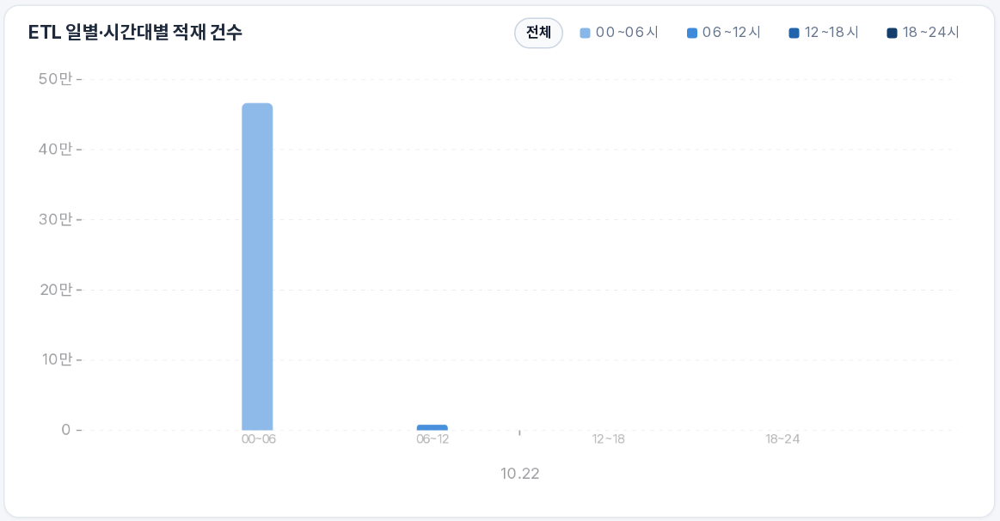
  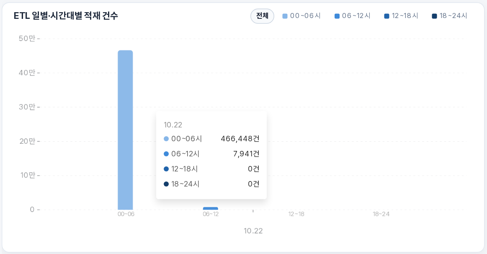
</p>


> **💡 부연설명 · 시간대별 상세 보기**
>
> 차트 위의 시간대를 선택하면 해당 구간을 1시간 단위로 볼 수 있습니다. 같은 시간대를 다시 누르거나 **전체**를 선택하면 전체 구간 보기로 돌아갑니다.
>
> 

<a id="section-2-2-2"></a>

#### 2.2.2 ETL Job Top 5

- **건수**: 조회 기간의 적재 건수가 많은 작업을 확인합니다. 막대에 마우스를 올리면 정확한 건수가 표시됩니다.
- **소요시간**: 평균 실행 시간이 긴 작업을 확인합니다. 막대에 마우스를 올리면 소요시간이 초 단위로 표시됩니다.
- **실패**: 조회 기간의 실패 횟수가 많은 작업을 확인합니다. 막대에 마우스를 올리면 실패 횟수가 표시됩니다.

<p align="center">
  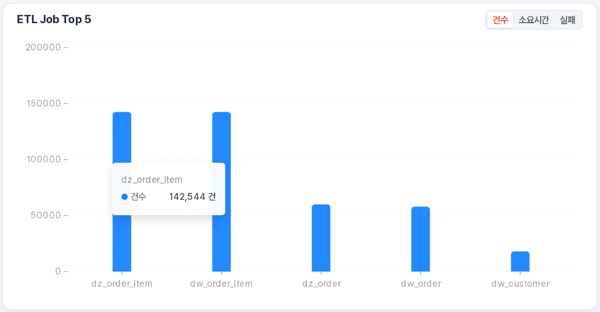
  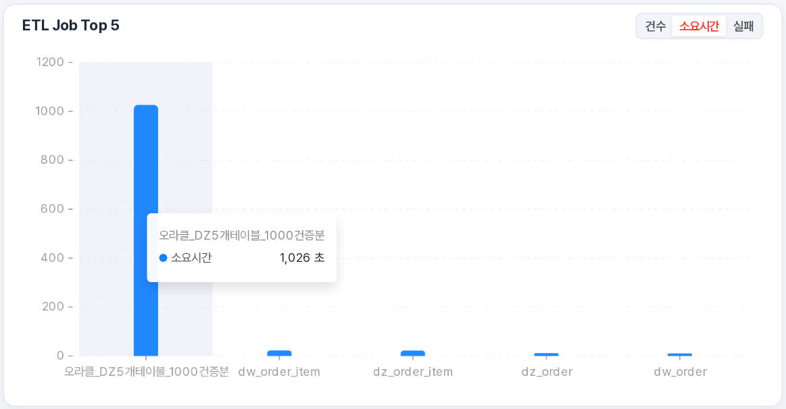
  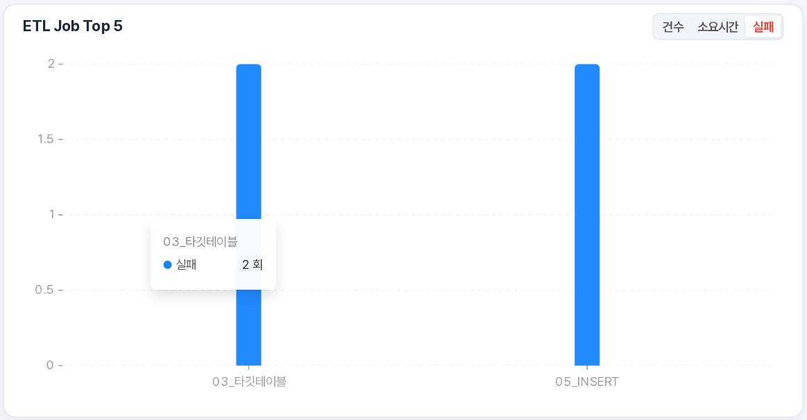
</p>

확인할 막대를 클릭하면 해당 작업의 [ETL 로그](#section-3-3)로 이동할 수 있습니다.

<a id="section-2-2-3"></a>

#### 2.2.3 CDC 일별·시간대별 처리 건수


- 일 처리 건수와 시간대별 분포를 확인합니다.
- 필요한 경우 시간대를 선택하여 1시간 단위의 처리량을 확인합니다.

<a id="section-2-2-4"></a>

#### 2.2.4 CDC Job 처리 건수 Top 5


- 선택한 기간에 처리량이 큰 CDC 작업을 확인합니다.
- 막대에 마우스를 올려 수치를 확인합니다.
- 상세 확인이 필요하면 CDC 요약 카드의 [로그](#section-4-3) 또는 [CDC → 로그](#section-4-3)로 이동합니다.


<a id="section-2-3"></a>

### 2.3 조회 기간 및 검색

조회 기간은 요약 카드와 처리 추이에서 확인할 이력의 범위를 정하는 기능입니다.


1. 상단의 **당일** 또는 **전일**을 선택합니다.
2. 다른 기간을 확인하려면 시작일과 종료일을 지정한 후 **검색**을 클릭합니다.
3. 변경된 기간에 맞는 처리·실행 결과를 확인합니다.

> **💡 부연설명 · 날짜와 현재 상태의 구분**
>
> - 시스템 리소스와 ETL의 \*중지, \*대기 데이터는 현재 상태입니다. 과거 날짜를 선택해도 해당 시점의 상태로 바뀌는 항목이 아닙니다.

<a id="section-2-4"></a>

### 2.4 시스템 리소스

시스템 리소스는 서비스가 사용하는 CPU·메모리·디스크 상태를 확인하는 영역입니다. 각 카드의 사용률과 정상·경고·위험 표시를 먼저 확인하고, 필요할 때만 상세 내역을 펼칩니다.

<a id="section-2-4-1"></a>

#### 2.4.1 CPU 사용률


- **CPU 사용률**과 정상·경고·위험 표시를 확인합니다.
- 표시된 코어 수를 함께 확인합니다.
- 사용률이 높으면 데이터 처리량과 실행 중인 작업을 함께 확인합니다.

> **💡 부연설명 · 상세 프로세스 확인**
>
> **상세**를 클릭하면 프로세스별 자원 사용 정보를 조회할 수 있습니다. 필요한 경우 **다시 읽기**로 최신 값을 확인합니다. 서버 전체 또는 제한된 실행 환경 중 어느 범위의 정보인지 창의 안내를 확인합니다.
>
> 

<a id="section-2-4-2"></a>

#### 2.4.2 메모리 사용률


- **메모리 사용률**과 정상·경고·위험 표시를 확인합니다.
- **사용량 / 전체 용량**과 **여유 용량**을 확인합니다.

> **💡 부연설명 · 메모리 상세**
>
> - **버퍼/캐시**: 파일 읽기·쓰기 속도를 높이려고 임시로 사용하는 메모리입니다. 메모리가 필요하면 운영체제가 회수할 수 있습니다.
> - **여유**: 현재 아무 용도로도 사용하지 않는 RAM 공간입니다.
> - **스왑 사용**: RAM에서 자주 사용하지 않는 데이터를 디스크의 보조 공간으로 옮겨 보관한 용량입니다.

<a id="section-2-4-3"></a>

#### 2.4.3 디스크 사용률


-  **디스크 사용률**과 정상·경고·위험 표시를 확인합니다.
-  **사용량 / 전체 용량**과 **여유 공간**을 확인합니다.

> **💡 부연설명 · 디스크 상세 및 알림 연결**
>
> **디스크 상세**를 펼치면 다음 항목별 점유량을 확인할 수 있습니다.
>
> - **CDC 로그**: CDC로 수집한 변경 데이터와 메시지를 Kafka가 보관하는 공간입니다.
> - **ETL 콘텐츠**: 수집·변환·적재 과정에서 다루는 실제 데이터 내용을 저장하는 공간입니다.
> - **ETL 프로버넌스**: 데이터가 언제 수신·변환·전송되었는지 처리 이력을 저장하는 공간입니다.
> - **ETL FlowFile**: 처리 중이거나 대기 중인 데이터 묶음의 속성·대기열 위치·처리 상태를 기록하는 공간입니다.
> - **ETL 데이터베이스**: ETL 실행 엔진의 작업 구성 변경 이력을 저장하는 내부 관리용 데이터베이스 공간입니다.
>
> 경고·위험 시 표시되는 조치 대기열 보기로 관련 알림을 확인할 수 있습니다. 일부 상세 값은 측정 방식에 따른 설명이 함께 표시됩니다.

<a id="section-2-5"></a>

### 2.5 조치 대기열

조치 대기열은 확인이 필요한 알림을 모아 보여 주는 영역입니다. 화면 위쪽의 위험·경고·정보 표시에서 현재 확인할 항목이 있는지 살펴봅니다.


1. 상단 알림 표시를 클릭하여 **조치 대기열**을 엽니다.
2. 알림의 대상, 내용, 중요도와 지속시간을 확인합니다.
3. 항목의 **로그**, **실행 이력** 또는 표시된 바로가기로 이동합니다.
4. 관련 화면에서 원인을 확인하고 필요한 조치를 진행합니다.

> **💡 부연설명 · 확인 처리와 알림 상태**
>
> - 항목의 **확인**은 알림을 읽었다는 기록을 남기는 기능입니다. 데이터 처리 오류 자체를 복구하는 기능은 아닙니다.
> - 확인한 항목은 대기열 목록에서 빠지고, 상단의 **확인됨** 건수가 증가합니다.
>
> 

<a id="section-2-6"></a>

### 2.6 주요 프로세스 현황

주요 프로세스 현황은 데이터 처리에 필요한 서비스가 동작하는지 확인하는 영역입니다.


- **이상 없음** 또는 이상 개수 표시를 확인합니다.
- 이상이 있는 경우 항목의 이름과 상태를 확인합니다.


<a id="section-3"></a>

## 3. ETL

ETL은 데이터베이스, 파일, 외부 API 등에서 데이터를 가져와 필요한 형태로 변환하고 대상에 적재하는 기능입니다. **생성**에서 작업을 만들고, **파이프라인**에서 구성을 확인·수정하며, **로그**에서 실행 결과를 확인합니다.

| 메뉴 | 주요 기능 | 이용 순서 |
|---|---|---|
| **ETL → 생성** | 생성마법사로 적재 작업 생성 | 소스 유형 선택 → 기본 정보 → 연결 및 적재 설정 |
| **ETL → 파이프라인** | 작업 탐색, 로직 수동 설계, 설정 확인 및 수정 | 그룹 선택 → 작업 확인 → 필요 시 설정 변경 |
| **ETL → 로그** | 처리 이력, 적재 건수 및 오류 확인 | 기간 지정 → 작업 검색 → 결과 및 상세 로그 확인 |

> **사용 순서**    
 DB 연결이 필요하면 [6.1 연결정보](#section-6-1)에서 먼저 등록합니다. 정기 실행이나 여러 작업의 순서 제어가 필요하면 ETL 작업을 만든 후 [5. 워크플로우](#section-5)에서 연결합니다.

<a id="section-3-1"></a>

### 3.1 ETL 생성

ETL 생성은 수집할 데이터의 유형에 맞는 작업을 단계별로 만드는 기능입니다.  
원본과 적재 대상을 정한 후 화면의 **다음** 버튼으로 순서대로 진행하고, 마지막 **완료** 버튼으로 작업을 등록합니다.


>**시작하기 전에**
>
>- ETL 생성 권한이 있는 계정으로 로그인합니다.
>- 소스·타깃 DB 연결과 사용할 스키마·테이블을 준비합니다. ETL 생성마법사는 조회된 타깃 테이블을 선택하는 흐름입니다.  

<br>
  


| 생성 유형 | 사용 목적 | 주요 설정 |
|---|---|---|
| **DB → DB 적재** | 소스 DB의 조회 결과를 타깃 DB에 적재 | 양쪽 DB 연결, 조회 SQL, 적재 방식, 컬럼 매핑 |
| **파일 적재** | CSV·Excel 파일의 표 데이터를 타깃 DB에 적재 | 파일 선택 |
| **HTTP 수집** | 외부 HTTP API의 응답 데이터를 수집하여 적재 | API 연결 테스트, 응답 컬럼 매핑 |
| **비정형 전송** | 이미지·영상 등 비정형 파일을 처리하는 작업 생성 | 생성 완료 후 입력 파일 추가 |

<a id="section-3-1-1"></a>

#### 3.1.1 DB → DB 적재

소스 데이터베이스에서 데이터를 조회한 후 타깃 데이터베이스에 추가하거나 갱신하는 작업을 생성합니다. 전체 교체, 누적 적재, 기본키 기반 갱신 중 업무 목적에 맞는 방식을 선택할 수 있습니다.

##### 1단계 · 유형 선택


1. 상단 **ETL → 생성**을 클릭합니다.
2. **DB -> DB 적재** 항목을 선택합니다.
3. **다음** 버튼을 클릭합니다.


##### 2단계 · 기본 정보

1. **작업명**에 처리 목적을 알 수 있는 이름을 입력합니다.
2. **상위 그룹**에서 작업을 생성할 위치를 선택합니다.
3. **다음** 버튼을 클릭합니다.

| 항목 | 설명 | 입력 예시 |
|---|---|---|
| 작업명 | 생성할 ETL 작업의 이름 | ORDER_DB_LOAD |
| 상위 그룹 | 작업을 보관할 업무 그룹 | 등록된 업무 그룹 선택 |
| 설명 | 작업의 목적과 처리 범위 | 주문 데이터를 조회하여 분석 DB에 적재 |

> **💡 부연설명 · 설명 입력(선택)**
>
> 작업명과 상위 그룹은 필수 항목입니다. **설명**에는 필요한 경우 소스·타깃이나 담당 업무 등을 입력합니다.
>
>
> 

<br>

##### 3단계 · 연결 설정


1. **소스 연결**에서 원본 DB 연결을 선택합니다.
2. **소스 데이터베이스**에 표시된 DB 종류를 확인합니다. 종류가 자동으로 확인되지 않으면 사용할 종류를 선택합니다.
3. **소스 스키마**, **소스 테이블**을 차례로 선택합니다.
4. **타깃 연결**에서 데이터를 저장할 DB 연결을 선택합니다.
5. **타깃 데이터베이스**, **타깃 스키마**, **타깃 테이블**을 확인·선택합니다.
6. 소스와 타깃의 방향이 맞는지 확인한 후 **다음** 버튼을 클릭합니다.


- 스키마와 테이블은 목록에서 검색하여 선택할 수 있습니다.
- 소스 테이블은 여러 개 선택할 수 있습니다. 여러 테이블을 선택하면 다음 단계에서 조인 조건을 확인합니다.
- 스키마를 변경하면 테이블을 다시 선택합니다. 목록이 조회되지 않으면 연결 등록 상태와 DB 접근 권한을 확인합니다.


##### 4단계 · 적재 쿼리

1. **적재 방식**을 선택합니다.
2. **적재로직 SQL문**에 작성된 소스 조회 SQL을 확인합니다.
3. 필요한 컬럼, 별칭, 조회 조건 및 조인 조건을 수정합니다.
4. 조회할 내용이 맞으면 **다음** 버튼을 클릭합니다.


| 적재 방식 | 처리 내용 | 선택할 때 확인할 사항 |
|---|---|---|
| **INSERT** | 빈 테이블에 초기 데이터를 적재하거나, 기존 데이터를 유지하면서 조회 결과를 추가 |타깃 컬럼의 자료형, 필수값, 기본키·외래키 조건에 맞는 데이터인지 확인 |
| **TRUNCATE 후 적재** | 타깃 테이블의 기존 데이터를 모두 삭제한 뒤 소스 데이터를 적재 | 데이터량이 많으면 전체 재적재에 오래 걸릴 수 있으므로 실행 시간과 운영 영향 확인 |
| **UPSERT** | 기준키가 일치하는 데이터는 갱신하고, 일치하는 데이터가 없으면 새로 추가 | 복합 기본키는 모든 키 컬럼을 매핑했는지 확인 |

**적재로직 SQL문 작성**

- 화면에서 생성한 SQL을 시작점으로 사용하고, 실제 가져올 컬럼과 범위에 맞게 수정합니다.
- 자동 대응되지 않은 컬럼은 소스 컬럼이나 필요한 식을 직접 지정합니다.
- 여러 테이블을 선택한 경우 테이블 별칭과 조인 조건을 확인합니다.
- UPSERT의 SQL에 갱신 기준 컬럼·조회 기간의 예시 표현이 남아 있으면 실제 조건으로 바꿉니다.


> **💡 부연설명 · 조회 SQL 유효성 체크(선택)**
>
> SQL을 편집한 뒤 미리 점검하려면 **유효성 체크**를 클릭합니다. 소스 DB 기준의 조회 SQL을 확인하는 기능이며, 다음 단계로 이동하기 위한 필수 버튼은 아닙니다. 오류가 표시되면 내용을 참고하여 SQL을 수정합니다.

##### 5단계 · 컬럼 매핑

1. 왼쪽 **소스컬럼**과 오른쪽 **타깃컬럼** 목록을 확인합니다.
2. 이름이 같은 컬럼의 자동 연결 결과를 확인합니다.
3. 연결되지 않은 소스컬럼을 해당 타깃컬럼으로 드래그합니다.
4. 필요한 값이 타깃컬럼에 연결되었으면 **완료** 버튼을 클릭합니다.


> **💡 컬럼 연결 편집**
>
> - 연결 삭제 : 연결선을 더블클릭하여 삭제한 후 원하는 소스컬럼을 연결합니다.
> - 이미 연결된 타깃컬럼에 다른 소스컬럼을 추가하면 결합 식이 구성됩니다. 연결 후 처리 로직을 확인합니다.
> - 소스·타깃 컬럼의 위·아래 이동 버튼으로 목록의 표시 순서를 조절할 수 있습니다. (Drag&Drop 방식도 가능)
>
> **💡 미연결 컬럼 처리**
>
> DB 기본값이 있는 타깃 컬럼은 매핑 없이 기본값을 사용할 수 있습니다. 그 외 미연결 컬럼은 NULL 처리와 필수값 조건을 확인합니다. 
>
<!--
> **💡 유효성 체크**
>유효성 체크는 SQL 문법과 컬럼 매핑을 점검합니다. 실제 적재 시에는 데이터 값과 타깃 DB의 제약조건에 따라 오류가 발생할 수 있습니다.
-->


> **💡 처리 로직 편집**
>
> 1. 타깃컬럼 왼쪽의 **처리 로직 편집**  아이콘을 클릭합니다.
> 2. **변환 - 처리 로직** 창에서 대상 컬럼을 확인합니다.
> 3. 문자열 결합, 계산, 기본값 처리 또는 형식 변환에 필요한 식을 입력합니다.
> 4. **확인** 버튼으로 식을 적용하고 컬럼 매핑으로 돌아갑니다.  
>
>
> **💡 유효성 체크와 도움말(선택)**
>
> 컬럼 매핑 영역이나 처리 로직 창의 **유효성 체크**는 매핑용 SQL(Calcite) 문법과 연결 정합성을 미리 확인할 때 사용합니다. 변환 식 작성법이 필요하면 **도움말**을 확인합니다. 
 


##### 생성 완료 확인

1. **ETL 템플릿 그룹 생성 완료** 메시지를 확인합니다.
2. 1) **캔버스에서 보기** 또는 **ETL → 파이프라인**에서 작업을 확인합니다.  
   2) 
3. 정기 실행이 필요하면 생성한 작업을 워크플로우에 배치합니다.
4. 실행 후 **ETL → 로그**에서 성공 여부와 적재 건수를 확인합니다.

> **💡 부연설명**
>
> 생성 완료는 작업 구성이 등록되었다는 의미입니다. 실제 데이터 적재는 작업이 실행될 때 수행됩니다.


<p align="center">
  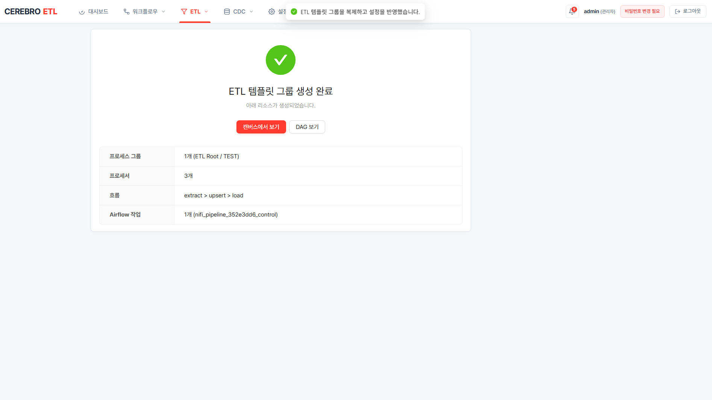
</p>


<a id="section-3-1-2"></a>

#### 3.1.2 파일 적재

CSV 또는 Excel 파일의 데이터를 타깃 DB에 적재하는 작업을 생성합니다. 기본 정보 단계에서 파일을 선택하고, 연결 단계에서 적재할 테이블을 지정합니다.

##### 1단계 · 유형 선택

1. **ETL → 생성**에서 **파일 적재**를 선택합니다.
2. **다음** 버튼을 클릭합니다.

<p align="center">
  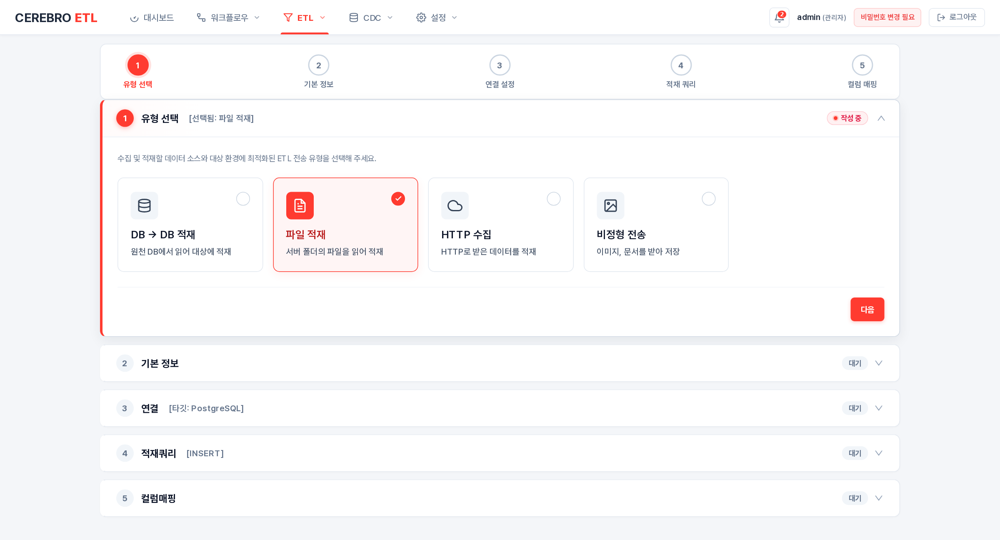
</p>

##### 2단계 · 기본 정보와 파일 선택

1. **작업명**을 입력하고 **상위 그룹**을 선택합니다.
2. **파일확장자**에서 **csv** 또는 **excel**을 선택합니다.
3. **파일선택**을 클릭하여 업로드할 파일을 선택합니다. 여러 파일을 선택할 수 있습니다.
4. 선택된 파일 수와 확장자를 확인한 후 **다음** 버튼을 클릭합니다.


<!--| log·json | 현재 생성 화면에서는 선택할 수 없습니다. |-->


> **💡 부연설명**
>
> 파일 헤더에서 컬럼 정보를 확인하므로 파일의 컬럼명이 적재 대상과 맞는지 확인합니다. 여러 파일은 같은 대상 테이블에 적재할 수 있는 구조로 준비합니다.


##### 3단계 · 타깃 연결

1. **타깃 연결**을 선택합니다.
2. **타깃 데이터베이스** 종류를 확인합니다.
3. **타깃 스키마**와 **타깃 테이블**을 선택합니다.
4. **다음** 버튼을 클릭합니다.

##### 4·5단계 · 적재 설정 확인 및 완료

1. 적재 쿼리 단계에서 **INSERT**로 표시되는 적재 방식을 확인합니다.
2. **다음**을 클릭하고 컬럼 매핑 단계의 설정을 확인합니다.
3. **완료**를 클릭하여 파일 업로드와 작업 생성을 진행합니다.
4. 완료 화면에서 **캔버스에서 보기**를 클릭하여 파일 입력과 타깃 구성을 확인합니다.  


> **💡 부연설명**
>
> 파일 적재의 적재 쿼리·컬럼 매핑 단계는 현재 INSERT 확인 중심으로 제공됩니다. 추가 가공이 필요하면 생성 후 캔버스에서 구성합니다.


<p align="center">
  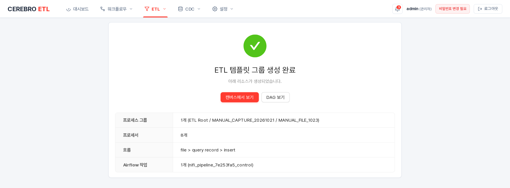
</p>

##### 생성 후 파일 추가

1. **ETL → 파이프라인**에서 해당 작업을 선택합니다.
2. 오른쪽 **상세정보 → 테이블** 영역에서 입력 경로와 **파일 추가** 버튼을 확인합니다.
3. **파일 추가**로 같은 처리 대상에 사용할 파일을 추가합니다.
4. 추가한 파일을 확인하고 작업을 실행한 후 로그를 확인합니다.

<a id="section-3-1-3"></a>

#### 3.1.3 HTTP 수집

외부 HTTP API에 요청하여 받은 데이터를 타깃 DB에 적재하는 작업을 생성합니다. API 테스트 결과를 확인한 후 응답에서 가져올 컬럼을 매핑합니다.


##### 1·2단계 · 유형과 기본 정보

1. **ETL → 생성**에서 **HTTP 수집**을 선택하고 **다음**을 클릭합니다.
2. **작업명**을 입력하고 **상위 그룹**을 선택합니다.
3. **다음** 버튼을 클릭합니다.
<p align="center">
  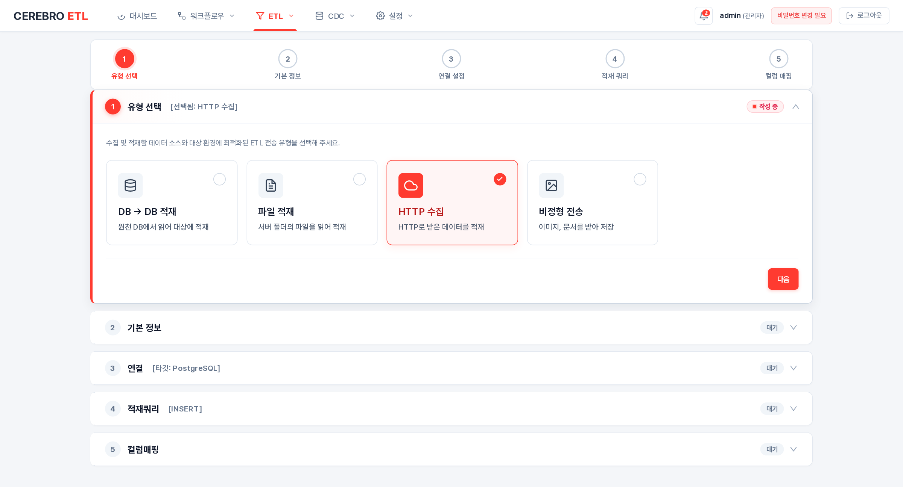
</p>

##### 3단계 · HTTP 요청과 타깃 연결

1. HTTP 요청 방식에서 **GET** 또는 **POST**를 선택합니다.
2. **API URL**에 수집할 주소를 입력합니다.
3. 인증이 필요한 경우 **API KEY**를 입력합니다.
4. **JSON API 테스트** 또는 **파일 다운로드 테스트**를 클릭하여 응답을 확인합니다.
5. **타깃 연결**, **타깃 데이터베이스**, **타깃 스키마**, **타깃 테이블**을 지정합니다.
6. **다음** 버튼을 클릭합니다.


> **💡 API 테스트**
>
>
>| 테스트 | 확인할 내용 |
>|---|---|
>| **JSON API 테스트** | JSON 응답이 정상적으로 수신되는지 확인하고, 다음 단계에서 소스 JSON과 매핑 컬럼을 확인합니다. |
>| **파일 다운로드 테스트** | 다운로드 응답이 정상인지 확인합니다. 다운로드 성공 자체가 JSON 컬럼을 생성하는 것은 아닙니다. |  


##### 4단계 · 적재 방식과 소스 JSON 확인

1. **적재 방식**에서 **INSERT** 또는 **UPSERT**를 선택합니다.
2. **소스 JSON**에서 실제 응답을 확인합니다.


##### 5단계 · 응답 컬럼 매핑 및 완료

1. JSON 응답에서 추출된 **소스컬럼**과 선택한 테이블의 **타깃컬럼**을 확인합니다.
2. 자동 연결 결과를 확인하고, 필요한 컬럼은 드래그하여 연결합니다.
3. **완료** 버튼으로 작업을 생성합니다.


<p align="center">
  
</p>

<a id="section-3-1-4"></a>

#### 3.1.4 비정형 전송

이미지·문서 등 비정형 파일을 처리할 작업을 생성합니다. 생성마법사에서는 작업 정보와 타깃을 설정하고, 생성한 파이프라인에서 입력 파일과 세부 처리 구성을 확인합니다.


##### 1·2단계 · 유형과 기본 정보

1. **ETL → 생성**에서 **비정형 전송**을 선택하고 **다음**을 클릭합니다.
2. **작업명**을 입력하고 **상위 그룹**을 선택합니다.
3. **다음** 버튼을 클릭합니다.
<p align="center">
  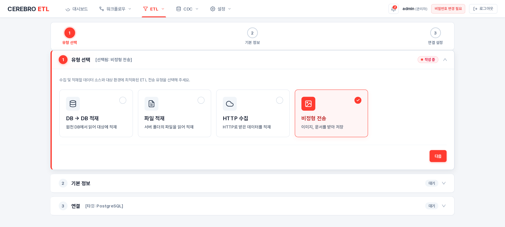
</p>

##### 3단계 · 타깃 연결 및 완료

1. **타깃 연결**과 **타깃 데이터베이스**를 확인·선택합니다.
2. **타깃 스키마**와 **타깃 테이블**을 선택합니다.
3. **완료** 버튼으로 작업을 생성합니다.


<p align="center">
  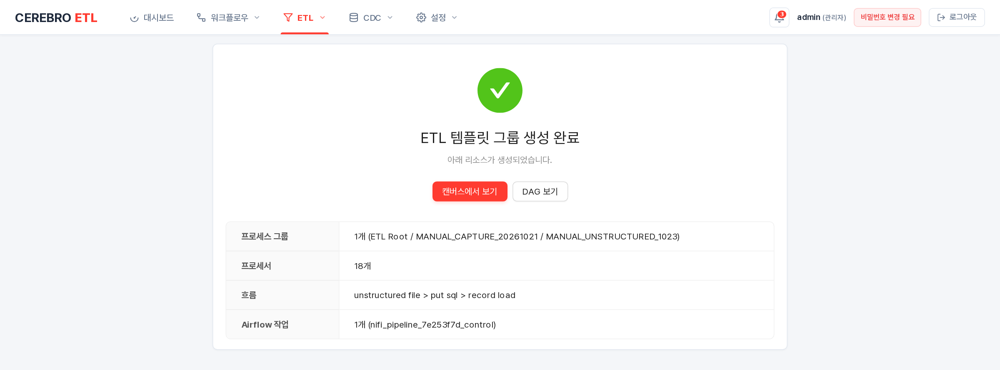
</p>

##### 생성 후 입력 파일 및 처리 확인

1. **ETL → 파이프라인**에서 생성한 작업을 선택합니다.
2. 작업의 파일 입력 경로와 처리 구성을 확인합니다.
3. **파일 추가**가 표시되는 작업은 해당 버튼으로 입력 파일을 추가합니다.
4. 수집 파일 형식과 타깃 테이블 구성이 해당 템플릿의 처리 목적에 맞는지 확인합니다.
5. 작업을 실행하고 **ETL → 로그**에서 처리 결과를 확인합니다.

> **💡 부연설명**
>
> 비정형 파일의 저장·기록 방식은 구성된 파이프라인에 따라 결정됩니다. 사용할 파일 형식이나 추가 변환이 필요한 경우 캔버스 설정을 확인합니다.

<a id="section-3-2"></a>

### 3.2 ETL 파이프라인

ETL 파이프라인은 생성한 작업을 확인·편집하는 기능입니다. **ETL → 파이프라인**에서 작업을 선택한 뒤 생성마법사로 수정하거나, 캔버스에서 수동으로 구성할 수 있습니다. 생성한 작업을 편집하는 방법부터 안내합니다.

| 화면 영역 | 역할 |
|---|---|
| **왼쪽 트리** | 업무 그룹과 작업을 찾아 선택합니다. |
| **가운데 캔버스** | 처리 구성과 연결 관계를 확인·편집합니다. |
| **오른쪽 상세정보** | 작업 정보와 생성마법사 수정 버튼을 확인합니다. |

<a id="section-3-2-1"></a>

#### 3.2.1 생성마법사로 만든 작업 수정

생성마법사에서 만든 ETL 작업은 저장된 설정을 다시 열어 편집할 수 있습니다. 작업을 새로 만드는 경우는 **3.1 ETL 생성**을, 기존 작업을 바꾸는 경우는 아래 유형별 절차를 따릅니다.

**수정 화면 열기**

1. **ETL → 파이프라인**을 클릭합니다.
2. 왼쪽 트리에서 수정할 작업을 선택합니다.
3. 오른쪽 **상세정보**에서 **생성마법사 수정**을 클릭합니다.
4. 새로 열린 수정 화면에서 작업명과 유형을 확인합니다.
5. 해당 유형의 절차에 따라 편집한 뒤 **완료**로 반영합니다.

> **💡 부연설명**
>
> 수정 화면에서는 생성 유형, 상위 그룹과 적재 방식을 변경할 수 없습니다. 해당 항목을 바꾸려면 새 작업을 생성합니다. **생성마법사 수정**은 마법사로 만든 작업에서 표시되며, 수동 작업은 캔버스에서 편집합니다.


<a id="section-3-2-1-1"></a>

##### 3.2.1.1 DB → DB 수정·편집

1. 수정 화면의 **기본 정보**에서 작업명·설명을 편집합니다.
2. **연결 설정**에서 소스·타깃 연결, 스키마와 테이블을 확인하고 변경할 항목을 지정합니다.
3. **적재 쿼리**에서 기존 적재 방식과 조회 SQL을 확인합니다. 필요한 컬럼·조건·조인 식을 수정합니다.
4. **컬럼 매핑**에서 변경한 조회 결과가 타깃컬럼에 연결되도록 조정합니다.
5. **완료**를 클릭합니다.
6. **ETL 생성마법사 편집 완료**를 확인하고 캔버스에서 수정 결과를 확인합니다.

> **💡 부연설명 · 변경 후 확인 및 선택 기능**
>
> - 연결·테이블을 바꾸면 이후 SQL과 매핑을 다시 확인합니다. UPSERT는 기본키 값이 유지되어야 합니다.
> - 변환이 필요할 때 **처리 로직 편집**을 사용합니다.
> - 수정 후에는 업무에 맞는 실행 시점을 정하고 결과를 로그에서 확인합니다.
>
> 

<a id="section-3-2-1-2"></a>

##### 3.2.1.2 파일 적재 수정·편집

1. **기본 정보**에서 작업명·설명과 파일 유형을 확인합니다.
2. 기존 파일 입력을 사용할 때는 파일을 다시 고르지 않고 **기존 입력 경로 사용** 표시를 확인합니다. 새 파일로 구성할 경우 **파일선택**으로 파일을 지정합니다.
3. **연결 설정**에서 타깃 연결, 스키마와 테이블을 확인·변경합니다.
4. 이후 단계에서 **INSERT** 적재 설정을 확인합니다.
5. **완료**를 클릭하고 편집 완료 메시지를 확인합니다.
6. 캔버스에서 입력 경로·타깃을 확인합니다.

> **💡 부연설명 · 파일 추가와 설정 수정의 구분**
>
> - 동일한 구조의 입력 파일만 추가할 경우 파이프라인 상세정보의 **파일 추가**를 사용할 수 있습니다.
> - CSV·Excel 유형을 바꾸거나 다른 구조의 파일을 선택하면 헤더와 타깃 컬럼이 맞는지 확인합니다.
> - 파일 적재는 현재 INSERT 방식이며, DB → DB와 같은 드래그 매핑 화면은 제공되지 않습니다. 추가 가공은 캔버스에서 구성합니다.
>
> 

<a id="section-3-2-1-3"></a>

##### 3.2.1.3 HTTP 수집 수정·편집

1. **기본 정보**에서 작업명·설명을 편집합니다.
2. **연결 설정**에서 요청 방식, **API URL**, **API KEY**와 타깃 연결을 확인·변경합니다.
3. 요청 방식·주소·키를 바꿨다면 API 테스트를 다시 수행하여 응답을 가져옵니다.
4. **적재 쿼리**에서 기존 적재 방식과 **소스 JSON**을 확인합니다.
5. **컬럼 매핑**에서 응답 컬럼과 타깃컬럼의 연결을 확인·변경합니다.
6. **완료**를 클릭하고 편집 완료 메시지를 확인합니다.
7. 캔버스에서 반영 결과를 확인합니다.

> **💡 부연설명 · 응답 구조가 바뀐 경우**
>
> API 변경으로 컬럼이 추가·삭제되거나 이름이 달라지면 기존 매핑과 처리 로직을 새 응답에 맞게 수정합니다. 매핑 **유효성 체크**는 필요할 때 사용하는 선택 기능입니다. HTTP 응답을 다시 가져오기 위한 API 테스트와는 별개입니다.
>
> 

<a id="section-3-2-1-4"></a>

##### 3.2.1.4 비정형 전송 수정·편집

1. **기본 정보**에서 작업명·설명을 편집합니다.
2. **연결 설정**에서 타깃 연결, 데이터베이스, 스키마와 테이블을 확인·변경합니다.
3. 연결 단계의 **완료**를 클릭합니다.
4. 편집 완료 메시지를 확인하고 캔버스에서 입력 경로·타깃 구성을 확인합니다.

> **💡 부연설명 · 입력 파일 및 세부 처리 변경**
>
> 비정형 전송은 적재 쿼리·컬럼 매핑 단계 없이 연결 단계에서 편집이 끝납니다. 입력 파일 추가는 해당 작업의 **파일 추가**를, 템플릿의 상세 처리 변경은 캔버스를 사용합니다.
>
> 

<a id="section-3-2-2"></a>

#### 3.2.2 작업 탐색 및 상세정보 확인

1. 트리에서 확인할 그룹을 펼치고 작업을 선택합니다.
2. **상세정보**에서 상태와 경로를 확인합니다.
3. 작업의 **소스테이블**, **타깃테이블** 또는 파일 입력 경로를 확인합니다.
4. **실행로그**에서 최근 처리 횟수와 적재 건수를 확인합니다.
5. 연결된 워크플로우가 표시되면 해당 링크로 이동하여 실행 설정과 결과를 확인합니다.


- 프로세스 그룹은 여러 처리 요소를 담는 작업 단위입니다. 그룹을 더블클릭하면 내부 구성으로 들어갑니다.
- 프로세서를 선택하면 해당 처리 요소의 상세정보가 표시됩니다.

<a id="section-3-2-3"></a>

#### 3.2.3 수동 파이프라인 설계

생성마법사 외의 처리 흐름이 필요할 때 캔버스에서 직접 작업을 구성합니다.

1. 작업을 둘 상위 그룹으로 이동합니다.
2. 캔버스 도구 모음의 **프로세스 그룹** 을 배치하고 이름을 지정합니다.
3. 생성한 그룹 안으로 들어가 **프로세서** 를 배치합니다.
4. 조회·읽기, 변환, 적재 등 필요한 처리 순서대로 프로세서를 구성합니다.
5. 각 프로세서의 설정 창에서 속성과 스케줄링을 설정하고 **적용**합니다.
6. 프로세서 간 연결을 만들고 전달할 관계를 선택합니다.
7. 실행에 필요한 컨트롤러 서비스를 설정·활성화합니다.
8. 유효하지 않은 설정이나 연결되지 않은 처리 관계가 없는지 확인합니다.


| 구성 요소 | 역할 |
|---|---|
| **프로세스 그룹**  | 하나의 ETL 작업 또는 업무별 처리 묶음을 구성합니다. |
| **프로세서**  | 데이터 조회, 파일 읽기, 변환, 적재 등 개별 처리를 수행합니다. |
| **연결** | 앞 프로세서의 처리 결과를 다음 프로세서로 전달합니다. |
| **컨트롤러 서비스** | DB 연결, 데이터 읽기·쓰기 형식 등 여러 프로세서가 참조할 설정을 제공합니다. |
| **파라미터 컨텍스트** | 해당 그룹에서 사용할 공통 변수 묶음을 지정합니다. |

> **💡 부연설명**
>
> 처리 결과의 성공·실패 관계를 전달하거나 종료하도록 설정해야 프로세서가 실행 가능한 상태가 됩니다. 구체적인 필수 속성은 프로세서 설정 창의 도움말을 확인합니다.

> **💡 부연설명 · DB → DB 작업을 수동으로 구성하는 예제**
>
> [3.1.1 DB → DB 적재](#section-3-1-1)에서 생성마법사로 만든 **조회 → 컬럼 매핑 → 적재** 흐름을 캔버스에서 직접 구성합니다. 예제는 `CSB.DZ_CUSTOMER`를 조회하여 컬럼을 맞춘 뒤 `CSB.DW_CUSTOMER`에 INSERT하는 구성입니다.
>
> 촬영용 그룹은 `MANUAL_DB_TO_DB_1101`입니다. 연결 서비스와 레코드 리더·작성기는 이미 준비된 항목을 사용하며, 실제 데이터 적재 없이 중지 상태로 구성했습니다.

##### 1단계 · 작업을 담을 프로세스 그룹 생성

1. **ETL → 파이프라인**에서 작업을 둘 상위 그룹으로 이동합니다.
2. 도구 모음의 **프로세스 그룹** 을 캔버스의 빈 곳으로 드래그합니다.
3. **이름**에 `MANUAL_DB_TO_DB_1101`을 입력하고 **Add**를 클릭합니다.
4. 생성된 그룹을 더블클릭하여 내부로 들어갑니다.


도구 모음이 접혀 있으면 캔버스 왼쪽 위의 **새로고침**을 클릭하여 펼칩니다. 파라미터 컨텍스트는 공통 변수를 사용할 때 선택합니다.

##### 2단계 · 조회·매핑·적재 프로세서 배치

1. **프로세서** 를 캔버스로 드래그합니다.
2. 추가 창에서 `ExecuteSQLRecord`를 찾아 선택하고 **Add**를 클릭합니다.
3. 같은 방법으로 `QueryRecord`와 `PutDatabaseRecord`를 추가합니다.
4. 각 프로세서에서 마우스 오른쪽 버튼을 클릭하고 **설정**을 열어 아래 이름을 지정합니다.


| 예제의 이름 | 프로세서 유형 | 역할 |
|---|---|---|
| **01_소스조회** | ExecuteSQLRecord | 소스 DB의 SELECT 결과를 데이터 묶음으로 만듭니다. |
| **02_컬럼매핑** | QueryRecord | 조회 결과의 컬럼명과 값을 타깃에 맞춥니다. |
| **03_타깃적재** | PutDatabaseRecord | 전달받은 데이터를 타깃 테이블에 적재합니다. |

##### 3단계 · 소스 DB와 조회 SQL 설정

1. `01_소스조회`의 **설정 → 속성**을 엽니다.
2. **Database Connection Pooling Service**에서 소스 DB의 연결 서비스를 선택합니다.
3. **SQL select query**에 소스 테이블의 조회 SQL을 입력합니다.
4. **Record Writer**를 `AvroRecordSetWriter`로 선택하고 **Apply**로 반영합니다.


예제는 `cha_oracle` 연결의 `CSB.DZ_CUSTOMER`에서 고객 정보 컬럼을 조회합니다. 실제 작업에서는 사용할 소스 연결과 테이블로 지정합니다.

| 설정 항목 | 확인할 내용 |
|---|---|
| **Database Connection Pooling Service** | 소스 DB에 접속할 연결 서비스 |
| **SQL select query** | 필요한 컬럼과 조회 범위를 지정한 SELECT 문 |
| **Record Writer** | 조회 결과를 기록할 형식. 다음 단계의 리더와 맞춥니다. |

> **💡 부연설명 · 공통 서비스 준비**
>
> DB 연결이 필요하면 [6.1 연결정보](#section-6-1)에서 먼저 등록합니다. 연결 서비스와 `AvroRecordSetWriter`·`AvroReader`는 사용할 그룹에서 선택할 수 있고 활성화된 상태여야 합니다. 목록에 없으면 해당 그룹의 **컨트롤러 서비스**에서 준비 여부와 사용 범위를 확인합니다.

##### 4단계 · 조회 결과의 컬럼 매핑

1. `02_컬럼매핑`의 **설정 → 속성**을 엽니다.
2. **Record Reader**를 `AvroReader`, **Record Writer**를 `AvroRecordSetWriter`로 선택합니다.
3. **+**로 `query` 속성을 추가하고 컬럼 매핑 SQL을 입력합니다.
4. 컬럼명과 별칭을 확인한 뒤 **Apply**로 반영합니다.


이 단계의 SQL은 소스 DB를 다시 조회하지 않고 앞 단계에서 전달한 **FLOWFILE**을 대상으로 실행합니다. 예제는 고객 정보 컬럼을 유지하면서 `CREATED_AT` 값을 `CDW_CREATED_AT` 컬럼에도 연결합니다.

```sql
SELECT
    CUSTOMER_ID AS CUSTOMER_ID,
    CUSTOMER_NAME AS CUSTOMER_NAME,
    -- 그 밖에 타깃으로 전달할 고객 정보 컬럼
    CREATED_AT AS CREATED_AT,
    CREATED_AT AS CDW_CREATED_AT
FROM FLOWFILE
```

위 SQL은 매핑 방식을 보여주는 일부 예시입니다. 실제 설정에는 타깃에 필요한 전체 컬럼을 입력합니다. `query`라는 속성 이름은 다음 단계로 연결할 **관계 이름**으로도 사용됩니다.

##### 5단계 · 타깃 DB와 적재 방식 설정

1. `03_타깃적재`의 **설정 → 속성**을 엽니다.
2. **Record Reader**를 앞 단계의 출력 형식에 맞는 `AvroReader`로 선택합니다.
3. **Database Connection Pooling Service**에서 타깃 DB의 연결 서비스를 선택합니다.
4. DB 종류, 적재 방식, 스키마와 테이블을 지정하고 **Apply**로 반영합니다.


| 설정 항목 | 예제의 값 |
|---|---|
| **Record Reader** | AvroReader |
| **Database Type** | Oracle 12+ |
| **Statement Type** | INSERT |
| **Database Connection Pooling Service** | cha_oracle |
| **Schema Name** | CSB |
| **Table Name** | DW_CUSTOMER |

예제는 같은 DB 연결의 서로 다른 테이블을 사용합니다. 다른 DB로 적재할 때는 소스 조회와 타깃 적재에 각각 해당 DB의 연결 서비스를 선택합니다. 적재 방식별 확인 사항은 [3.1.1 DB → DB 적재](#section-3-1-1)를 참고합니다.

##### 6단계 · 프로세서 연결과 최종 확인

1. `01_소스조회`의 연결점을 `02_컬럼매핑`으로 드래그하고 **success** 관계를 선택합니다.
2. `02_컬럼매핑`에서 `03_타깃적재`로 연결하고 **query** 관계를 선택합니다.
3. 연결할 후속 처리가 없는 관계는 프로세서의 **관계** 탭에서 자동 종료 여부를 지정합니다.
4. 연결 방향과 각 프로세서의 설정 상태를 확인합니다.


| 연결 | 선택할 관계 | 전달하는 데이터 |
|---|---|---|
| **01_소스조회 → 02_컬럼매핑** | success | DB에서 조회한 데이터 |
| **02_컬럼매핑 → 03_타깃적재** | query | 매핑 SQL을 적용한 데이터 |

> **💡 부연설명 · 연결하지 않은 관계와 실행 확인**
>
> 촬영용 예제는 조회의 `failure`, 매핑의 `original`·`failure`, 적재의 `success`·`failure`·`retry`를 자동 종료하도록 설정했습니다. 운영 작업에서 실패 데이터를 보관하거나 재처리해야 한다면 해당 관계를 별도의 처리 경로로 연결합니다.
>
> 설정이 완료되어도 **중지(Stopped)** 상태에서는 데이터가 적재되지 않습니다. 정기 실행과 작업 순서 관리는 [5. 워크플로우](#section-5), 실행 결과 확인은 [3.3 ETL 로그](#section-3-3)를 참고합니다.

**외부 프로그램과 코드 기반 처리**

파이프라인 중간에 외부 프로그램을 연결하여 필요한 계산이나 변환을 수행할 수 있습니다. 아래 예제는 **ExecuteStreamCommand**로 Python을 호출하여 입력 JSON에 주문 금액을 추가합니다.


> **💡 부연설명 · 기존 프로그램과 외부 라이브러리 사용**
>
> 외부 라이브러리가 필요한 경우에는 **Command Path에 지정한 Python 환경**에 설치되어 있어야 합니다. 실행 파일·라이브러리·입력 파일의 경로는 사용자의 PC가 아니라 NiFi가 실행되는 환경을 기준으로 지정합니다.
>
> Java 프로그램도 같은 방식으로 Java 실행 경로와 `-jar`·JAR 파일 경로를 지정하여 연결할 수 있습니다. 프로그램마다 입력·출력 방식과 종료 코드를 확인합니다.
>
> [Apache NiFi ExecuteStreamCommand 공식 설명](https://nifi.apache.org/components/org.apache.nifi.processors.standard.ExecuteStreamCommand/)

<a id="section-3-2-4"></a>

#### 3.2.4 실행 상태 확인 및 작업 운영

1. 실행 전에 DB 연결과 필수 컨트롤러 서비스가 준비되어 있는지 확인합니다.
2. 캔버스에서 작업 또는 프로세서를 선택하여 **시작**·**중지** 기능을 사용합니다.
3. 정해진 순서나 주기로 실행할 작업은 **5. 워크플로우**에 등록하여 운영합니다.
4. 실행 중 상태, 대기 데이터 및 알림을 확인합니다.
5. 실행 후 **ETL → 로그**에서 최종 결과를 확인합니다.

> **💡 부연설명**
>
> 캔버스의 실행·중지는 선택한 대상에 적용됩니다. 프로세서 하나의 실행 상태와 전체 작업의 최종 성공 여부를 함께 확인합니다. 수정할 때는 실행 중인 처리와 대기 데이터를 확인한 후 변경합니다.

<a id="section-3-2-5"></a>

#### 3.2.5 AI 어시스턴트 활용

1. 작업을 선택하고 오른쪽 **AI 어시스턴트** 탭을 클릭합니다.
2. 자동으로 표시되는 작업 요약을 확인합니다.
3. 필요한 질문을 입력합니다. 예: `이 작업의 소스와 타깃, 적재 방식을 설명해줘`.
4. 답변을 현재 SQL·매핑·로그와 함께 확인합니다.
5. 필요한 경우 **프롬프트 편집**에서 전달할 정보를 확인하고, **MD 저장하기**로 대화를 저장합니다.


> **💡 부연설명**
>
> AI 어시스턴트가 표시되지 않으면 **설정 → GPT → 관리**에서 사용할 항목이 선택되어 있는지 확인합니다. 대화는 별도로 저장할 수 있으며, AI의 설명을 참고하여 실제 작업 설정은 사용자가 확인·반영합니다.

<a id="section-3-2-6"></a>

#### 3.2.6 ETL 전역변수

여러 작업에서 반복 사용하는 값을 파라미터 컨텍스트로 묶어 관리합니다. 화면 이름은 **ETL 전역변수**이며, 실제 진입 위치는 **설정 → ETL 전역변수**입니다.

**변수 묶음 등록**

1. **설정 → ETL 전역변수**를 클릭합니다.
2. **신규 등록**을 클릭합니다.
3. **Name**에 변수 묶음의 이름을, **Description**에 설명을 입력합니다.
4. **파라미터 추가 +**를 클릭합니다.
5. 파라미터의 이름, 값, 민감정보 여부와 설명을 입력합니다.
6. 파라미터 창의 **OK**를 클릭합니다.
7. 필요한 파라미터를 추가한 뒤 변수 묶음 창의 **OK**로 최종 저장합니다.


| 입력 항목 | 설정 방법 |
|---|---|
| **이름** | 프로세서에서 참조할 파라미터 이름을 입력합니다. 예: `SOURCE_SCHEMA` |
| **값** | 해당 파라미터의 값을 입력합니다. |
| **빈 문자열 사용** | 값으로 빈 문자열을 명시적으로 사용할 때 선택합니다. |
| **민감정보 여부** | 비밀번호·키 등 민감한 값이면 **Yes**를 선택합니다. |
| **설명** | 변수의 용도와 입력 기준을 적습니다. |

**작업에 적용**

1. **ETL → 파이프라인**에서 사용할 프로세스 그룹의 설정을 엽니다.
2. 해당 그룹에 사용할 파라미터 컨텍스트를 지정합니다.
3. 파라미터를 지원하는 속성에 `#{SOURCE_SCHEMA}`처럼 이름을 참조합니다.
4. 적용 후 유효성 상태와 실제 처리 결과를 확인합니다.

**수정·삭제**

- 목록의 **수정**으로 묶음과 파라미터를 편집한 뒤 **OK**를 클릭합니다.
- 파라미터 추가 창에서 OK를 눌렀어도 바깥 변수 묶음을 저장해야 서버에 반영됩니다.
- **삭제** 전에는 해당 묶음을 사용하는 그룹을 확인합니다. 사용 중이어서 거절되면 연결 관계를 먼저 정리합니다.

> **💡 부연설명**
>
> 전역변수를 등록하는 것만으로 모든 작업에 일괄 적용되지는 않습니다. 사용할 그룹에 컨텍스트를 지정해야 합니다. Sensitive 값은 목록에서 원문 대신 민감정보로 표시되며, 수정 시 의도하지 않게 값을 비우지 않도록 확인합니다.

<a id="section-3-3"></a>

### 3.3 ETL 로그

ETL 로그는 작업 실행 결과와 처리 이력을 조회하는 기능입니다. 기간·그룹·상태를 기준으로 원하는 실행을 찾고, 실패한 작업은 상세 메시지를 확인하여 원인을 점검합니다.

<a id="section-3-3-1"></a>

#### 3.3.1 로그 조회

1. 상단 **ETL → 로그**를 클릭합니다.
2. **당일**, **전일** 또는 기간 선택으로 조회 범위를 지정합니다.
3. 필요한 경우 **job/경로/메시지 검색**과 **그룹(파이프라인)** 필터를 설정합니다.
4. **조회**를 클릭합니다.
5. 상단 대시보드의 전체 작업·실행 중·성공·실패를 확인합니다.
6. 상태 항목을 클릭하여 목록을 좁히거나, 같은 항목을 다시 선택하여 전체로 돌아갑니다.


<a id="section-3-3-2"></a>

#### 3.3.2 결과 확인

| 항목 | 확인할 내용 |
|---|---|
| **상태** | 실행 중, 성공, 실패 등 해당 기록의 상태 |
| **job·작업명** | 처리한 작업의 이름 |
| **시작·종료** | 해당 실행의 시작 시각과 종료 시각 |
| **소요시간** | 실행에 걸린 시간 |
| **적재 건수** | 확인 가능한 해당 실행의 데이터 적재량 |
| **경로** | 작업이 위치한 그룹 경로. 링크로 해당 파이프라인에 이동할 수 있습니다. |

> **💡 부연설명**
>
> 실행 이력과 오류·상태 기록이 함께 표시될 수 있습니다. 건수나 종료 시각이 없는 항목은 0건 완료로 단정하지 말고 기록 종류와 상태를 함께 확인합니다.

<a id="section-3-3-3"></a>

#### 3.3.3 실패 상세와 후속 확인

1. 실패한 행이나 **오류 상세 보기(+)**를 클릭합니다.
2. 상세 창의 **에러 로그**에서 실제 오류 내용을 확인합니다.
3. 연결 오류는 DB·API 연결, SQL 오류는 조회문, 매핑 오류는 처리 로직과 타깃 제약조건을 점검합니다.
4. 설정을 수정한 후 필요한 작업을 다시 실행합니다.
5. 새 실행의 성공 여부와 적재 건수를 다시 조회합니다.


> **💡 부연설명 · AI 오류 해석**
>
> GPT가 선택된 환경에서는 상세 창에 오류 해석이 자동으로 표시됩니다. 원문 오류를 확인하는 데 참고할 수 있습니다.

<a id="section-4"></a>

## 4. CDC

CDC는 원본 DB에서 발생하는 변경 데이터를 지속적으로 수집하여 대상 DB에 반영하는 기능입니다. 같은 메뉴에서 로그파일 적재도 구성할 수 있습니다. **생성**에서 파이프라인을 준비하고, **파이프라인**에서 설정과 상태를 확인하며, **로그**에서 처리량과 오류를 조회합니다.

| 메뉴 | 주요 기능 | 이용 순서 |
|---|---|---|
| **CDC → 생성** | 생성마법사로 DB → DB 적재 또는 로그파일 적재 파이프라인 생성 | 유형 선택 → 기본 정보 → 연결·대상 선택 → 실행 옵션 → 검토 및 생성 |
| **CDC → 파이프라인** | 파이프라인 탐색, 상태 확인, 수정, 그룹·정합성·삭제 관리 | 그룹 선택 → 파이프라인 확인 → 필요 시 수정·복구 |
| **CDC → 로그** | 처리 이력, 제어 기록, 지연건수 및 오류 확인 | 기간 지정 → 검색·필터 → 결과 및 상세 확인 |

> **사용 순서**    
 DB 연결이 필요하면 [6.1 연결정보](#section-6-1)에서 먼저 등록합니다. CDC 파이프라인은 생성만으로 수집을 시작하지 않습니다. 생성한 파이프라인을 [5.1.3 CDC 워크플로우 구성](#section-5-1-3)에 따라 워크플로우에 배치·게시한 후, [5.3.2 실행 설정](#section-5-3-2)에서 **시작**을 지시합니다. 시작·중지·재시작·배포는 모두 실행 설정에서 지시합니다.

<a id="section-4-1"></a>

### 4.1 CDC 생성

CDC 생성은 변경 데이터를 가져올 원본과 적재 대상을 지정하여 연계 작업을 등록하는 기능입니다.  
화면 위 **DB → DB 적재** 또는 **로그파일 적재** 버튼으로 유형을 고른 뒤 **다음** 버튼으로 단계를 진행하고, 마지막 **완료** 버튼으로 파이프라인을 등록합니다.


>**시작하기 전에**
>
>- CDC 쓰기 권한이 있는 계정으로 로그인합니다.
>- 소스·타깃 DB 연결을 [6.1 연결정보](#section-6-1)에 등록하고 연결 테스트를 완료합니다.
>- 테이블 CDC는 소스 테이블의 기본키와 DB의 변경분 캡처 설정·권한이 필요합니다. [6.1.3 연결 테스트 및 CDC 사전요건 점검](#section-6-1-3)을 참고합니다.
>- 타깃 스키마를 미리 준비합니다. 새 테이블을 만들 경우 타깃 연결 계정의 생성 권한을 확인합니다.
>- 로그파일은 수집 서비스(Filebeat)가 읽을 수 있는 경로에 준비합니다.

<br>

| 생성 유형 | 사용 목적 | 주요 설정 |
|---|---|---|
| **DB → DB 적재** | 원본 테이블의 추가·수정·삭제를 타깃 DB에 계속 반영 | 소스·타깃 연결 테스트, 대상 테이블, 스냅샷 모드, 적재 방식 |
| **로그파일 적재** | 로그파일에 새로 기록되는 줄을 수집하여 타깃 DB에 적재 | 로그 파일 경로, 타깃 테이블, 읽기 시작 위치 |

> **💡 부연설명 · 단계 이동**
>
> 단계는 자유롭게 오갈 수 있지만 생성은 1~4단계를 모두 완료해야 합니다. 연결 단계에서 소스와 타깃 연결 테스트가 모두 성공해야 대상 테이블을 선택할 수 있습니다.

<a id="section-4-1-1"></a>

#### 4.1.1 DB → DB 적재

원본 테이블의 변경 데이터를 다른 DB에 반영합니다. 한 번에 여러 소스 테이블을 선택할 수 있으며, 선택한 테이블별로 파이프라인이 생성됩니다.

##### 1단계 · 기본 정보

1. 상단 **CDC → 생성**을 클릭합니다.
2. 화면 위 **DB → DB 적재**가 선택되어 있는지 확인합니다.
3. **파이프라인 기본명**을 입력합니다.
4. 필요한 경우 **그룹**과 **설명**을 입력합니다.
5. **다음** 버튼을 클릭합니다.


| 항목 | 설명 | 입력 예시 |
|---|---|---|
| 파이프라인 기본명 | 파이프라인 이름. 여러 테이블을 선택하면 «기본명-테이블명»으로 각각 생성됩니다. | customer-cdc |
| 그룹 | CDC 파이프라인 트리에서 파이프라인이 놓일 그룹. 비워 두면 그룹 미지정 | 등록된 그룹 선택 |
| 유형 | 테이블 CDC로 고정 | 테이블 CDC |
| 설명 | 파이프라인의 목적과 담당 업무 | 고객 테이블 변경분을 분석 DB에 반영 |

> **💡 부연설명 · 이름 규칙과 그룹(선택)**
>
> 기본명은 영문·숫자로 시작하고 영문·숫자·밑줄(_)·하이픈(-)을 사용하여 3~100자로 입력합니다. **그룹**과 **설명**은 선택 항목입니다. 그룹은 [4.2.4 그룹 관리](#section-4-2-4)에서 미리 만들어 둘 수 있고, 생성 후 수정에서 지정해도 됩니다.

##### 2단계 · 연결

1. **소스 연결**을 선택하고 **소스 연결 테스트**를 클릭합니다.
2. **소스 연결 성공** 표시를 확인합니다.
3. **타깃 연결**을 선택하고 **타깃 연결 테스트**를 클릭합니다.
4. **타깃 연결 성공** 표시를 확인합니다.
5. **다음** 버튼을 클릭합니다.


> **💡 부연설명 · 연결 변경과 재테스트**
>
> 연결을 바꾸면 테스트 결과가 초기화되므로 바꾼 연결로 다시 테스트해야 진행할 수 있습니다. 목록에 연결이 없으면 **연결정보 등록** 버튼으로 [6.1 연결정보](#section-6-1)에서 먼저 등록합니다.

##### 3단계 · 대상 선택

1. **소스 스키마**와 **타깃 스키마**를 선택합니다.
2. 검색란에 테이블명 또는 패턴을 입력하여 소스 테이블을 찾습니다. 예: `dz_customer`, `TB_IMP%`
3. 적재할 소스 테이블을 체크합니다. 한 번에 최대 50개를 선택할 수 있습니다.
4. 각 소스에 대응할 **타깃 테이블**을 선택하거나 새 이름을 입력합니다.
5. 테이블별 점검 표시를 확인하고 **다음** 버튼을 클릭합니다.


| 항목 | 설명 | 입력 예시 |
|---|---|---|
| 소스 테이블 | 변경분을 가져올 테이블. 기본키가 있어 `PK · 컬럼명`이 표시된 테이블만 선택할 수 있습니다. | dz_customer |
| 타깃 테이블 | 기존 테이블을 선택하거나 새 이름을 입력합니다. 새 이름이면 **신규 생성 예정**이 표시됩니다. | manual_cdc_customer |
| 제외 컬럼(선택) | 타깃에 전송하지 않을 컬럼 | MEMO |
| 마스킹 컬럼(선택) | 값을 8자리로 가려 전송할 컬럼 | CUST_TEL |

> **💡 부연설명 · 선택할 수 없는 테이블과 컬럼**
>
> - `PK 없음`이 표시된 테이블은 체크할 수 없습니다. `변경분 캡처 불가`가 표시되면 원본 DB 설정을 먼저 확인합니다.
> - PostgreSQL 소스에 `삭제 전 값 제한 · DEFAULT`가 표시되면 삭제 이벤트에 기본키 외 컬럼 값이 비어서 전달됩니다. 표시에 마우스를 올려 안내를 확인합니다.
> - 기본키 컬럼은 제외·마스킹할 수 없습니다. 같은 컬럼을 제외와 마스킹에 함께 지정할 수 없고, **마스킹 불가**로 표시된 타입은 마스킹할 수 없습니다.
>
> **💡 부연설명 · 마스킹은 되돌릴 수 없음**
>
> CDC 마스킹은 타깃에 전달되는 값 자체를 바꿉니다. 이미 적재한 값은 마스킹을 해제해도 원본 값으로 복원되지 않습니다. 원본 조회가 필요한 컬럼인지 확인한 뒤 지정합니다.

##### 4단계 · 실행 옵션

1. **스냅샷 모드**를 선택합니다.
2. **Topic Prefix**를 확인합니다. 소스 연결을 고르면 `DB 종류-cdc`(예: `postgresql-cdc`)로 자동 입력됩니다.
3. **적재 방식**을 선택합니다.
4. 동기화는 **소스 DELETE 이벤트를 타깃에 반영** 여부를, 델타 방식은 **구분컬럼명**을 설정합니다.
5. 화면의 안내 내용을 확인하고 **다음** 버튼을 클릭합니다.


**스냅샷 모드**

| 선택 항목 | 처리 내용 |
|---|---|
| **초기 적재 후 CDC (권장)** | 최초 실행 시 기존 데이터를 가져온 후 이후 변경을 반영합니다. |
| **기존 데이터 미적재 · 이후 변경부터 CDC** | 기존 행을 가져오지 않고 커넥터 시작 이후의 변경만 수집합니다. 기존 데이터가 이미 대상에 있거나 별도로 초기 적재한 경우에 사용합니다. |

**적재 방식**

| 선택 항목 | 처리 내용 | 확인할 사항 |
|---|---|---|
| **동기화** | 기본키 기준으로 타깃을 소스와 같게 유지(갱신·추가) | 소스 DELETE 이벤트를 타깃에 반영할지 선택합니다. |
| **델타 최신상태** | 기본키당 한 행으로 마지막 상태와 작업 종류 저장 | 기존 타깃에는 구분컬럼과 소스 기본키에 대응하는 PK 또는 UNIQUE가 필요합니다. |
| **델타 append** | 변경 이벤트마다 새 행을 누적 | 작업 종류와 순번으로 변경 이력을 읽는 용도로 사용합니다. |

| 항목 | 설명 | 입력 예시 |
|---|---|---|
| Topic Prefix | 데이터가 전달되는 Topic 이름의 접두어. 실제 Topic은 `prefix.스키마.테이블` 형식입니다. | postgresql-cdc |
| 구분컬럼명 | 델타 방식에서 변경 종류를 기록할 컬럼 | cdc_op |

> **💡 부연설명 · 입력 규칙**
>
> - Topic Prefix는 영문·숫자·`.`·`_`·`-`만 사용할 수 있습니다.
> - 구분컬럼명은 영문으로 시작하는 영문·숫자·`_` 조합 30자 이하로 입력합니다. `cdc_seq`, `cdc_ts`는 시스템이 쓰는 이름이라 사용할 수 없습니다.
>
> **💡 부연설명 · 델타 방식의 컬럼**
>
> - 구분컬럼에는 `c`(추가), `u`(수정), `d`(삭제), `r`(초기 스냅샷 행)이 기록됩니다.
> - 델타 최신상태의 `cdc_ts`는 이벤트 시각이고, 델타 append의 `cdc_seq`는 이벤트 순서입니다.
> - 델타 방식은 삭제도 행으로 쌓으므로 DELETE 반영 옵션이 없습니다.

##### 5단계 · 검토 및 생성

1. 생성 개수, 소스·타깃 연결, 스냅샷 모드, 적재 방식, DELETE 반영을 확인합니다.
2. 테이블별 파이프라인명, 타깃, 제외·마스킹 컬럼과 Topic을 확인합니다.
3. **완료** 버튼을 클릭합니다.


> **💡 부연설명 · 여러 테이블을 한 번에 만들 때**
>
> 하나라도 생성에 실패하면 이번에 만든 파이프라인을 모두 지우고 «배치 생성 중 실패하여 생성된 파이프라인을 모두 정리했습니다» 메시지를 표시합니다. 메시지의 원인을 수정한 후 다시 생성합니다. 메시지 끝에 «수동 정리 필요»와 파이프라인 이름이 붙어 있으면 해당 파이프라인을 **CDC → 파이프라인**에서 삭제한 후 다시 생성합니다.

##### 생성 완료 확인

1. **N개 CDC 파이프라인 생성 완료** 메시지를 확인합니다. 생성한 파이프라인은 **실행 대기** 상태로 준비됩니다.
2. **파이프라인 목록** 버튼 또는 **CDC → 파이프라인**에서 등록 결과를 확인합니다.
3. [5.1.3 CDC 워크플로우 구성](#section-5-1-3)에 따라 워크플로우에 배치하고 게시합니다.
4. [5.3.2 실행 설정](#section-5-3-2)에서 **시작**을 지시합니다.
5. 실행 후 **CDC → 로그**에서 처리건수와 지연건수를 확인합니다.

| 완료 화면 버튼 | 동작 |
|---|---|
| **파이프라인 목록** | **CDC → 파이프라인**으로 이동합니다. |
| **워크플로우에서 열기** | **워크플로우 → 로그**로 이동합니다. |
| **하나 더 생성** | 입력값을 비우고 1단계부터 다시 시작합니다. |

> **💡 부연설명 · 생성과 실행의 차이**
>
> 생성 시 커넥터까지 준비되지만, 데이터 수집은 워크플로우에서 **시작**을 지시해야 시작됩니다. 동기화 방식의 새 타깃 테이블은 첫 데이터가 도착할 때 생성되며, 기존 데이터 미적재 모드에서는 새 변경이 오기 전까지 테이블이 보이지 않을 수 있습니다.

<p align="center">
  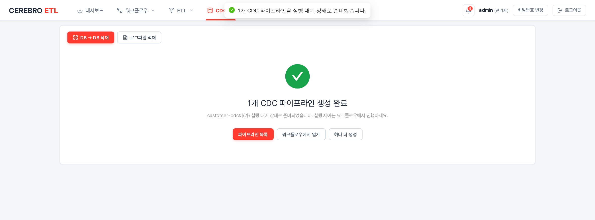
</p>

<a id="section-4-1-2"></a>

#### 4.1.2 로그파일 적재

애플리케이션 로그파일에 추가되는 내용을 수집하여 타깃 DB에 적재하는 파이프라인을 생성합니다.

##### 1단계 · 기본 및 파일 정보

1. **CDC → 생성** 화면 위 **로그파일 적재**를 클릭합니다.
2. **파이프라인명**을 입력합니다.
3. **로그 파일 경로**에 수집 서비스 기준 경로를 입력합니다.
4. 필요한 경우 **설명**을 입력합니다.
5. **다음** 버튼을 클릭합니다.


| 항목 | 설명 | 입력 예시 |
|---|---|---|
| 파이프라인명 | 로그 적재 파이프라인 이름 | app-log-ingest |
| 로그 파일 경로 | Filebeat(수집 서비스) 기준의 파일 경로 | /var/log/app/app.log |
| 설명(선택) | 수집할 로그의 용도 | 주문 서버 접근 로그 수집 |

> **💡 부연설명 · 로그 파일 경로와 그룹**
>
> 로그 파일 경로는 사용자 PC가 아니라 Filebeat가 실행되는 환경을 기준으로 합니다. 관리자가 연결해 둔 수집 경로(예: `/var/log/app`)를 확인하여 입력합니다. 로그파일 적재 마법사에는 그룹 칸이 없으므로, 그룹은 생성 후 [4.2.3 수정 및 변경 설정 반영](#section-4-2-3)에서 지정합니다.

##### 2단계 · 타깃 연결

1. **타깃 연결**을 선택합니다.
2. **타깃 연결 테스트**를 클릭합니다.
3. **타깃 연결 성공** 표시를 확인하고 **다음** 버튼을 클릭합니다.


| 항목 | 설명 | 입력 예시 |
|---|---|---|
| 타깃 연결 | 로그를 적재할 DB의 연결정보. 목록에 없으면 [6.1 연결정보](#section-6-1)에서 먼저 등록합니다. | tarantula-db |

##### 3단계 · 적재 대상

1. **타깃 스키마**를 선택합니다.
2. **타깃 테이블**에서 기존 테이블을 선택하거나 새 이름을 입력합니다.
3. **다음** 버튼을 클릭합니다.


| 항목 | 설명 | 입력 예시 |
|---|---|---|
| 타깃 스키마 | 로그를 적재할 스키마. 타깃 연결 테스트가 성공해야 선택할 수 있습니다. | public |
| 타깃 테이블 | 기존 테이블을 고르거나 새 이름을 입력합니다. 기존 테이블이 없으면 «기존 테이블 없음 - 새 이름 입력 가능»이 표시됩니다. | app_access_log |

##### 4단계 · 수집 옵션

1. 기존 로그까지 수집할지 결정하여 **읽기 시작 위치**를 선택합니다.
2. **인코딩**과 나머지 옵션을 확인하고 **다음** 버튼을 클릭합니다.


| 항목 | 설명 | 입력 예시 |
|---|---|---|
| 읽기 시작 위치 | **END (신규 라인부터)** 또는 **BEGINNING (파일 처음부터)** | END |
| 인코딩 | 로그파일에 사용한 문자 인코딩 | UTF-8 |
| CDC Topic(선택) | 비워 두면 `log-{파이프라인 ID}`로 자동 생성됩니다. | 비워 둠 |
| Agent Host(선택) | 수집 환경을 식별할 메타데이터용 이름 | filebeat |

##### 5단계 · 검토 및 생성

1. 파이프라인명, 로그 파일, 타깃 연결, 적재 대상, 읽기 시작, CDC Topic을 확인합니다.
2. **완료** 버튼을 클릭합니다.


##### 생성 완료 확인

1. **로그파일 파이프라인 생성 완료** 메시지를 확인합니다.
2. **파이프라인 목록** 버튼으로 이동하여 등록 결과를 확인합니다.
3. [5.1.3 CDC 워크플로우 구성](#section-5-1-3)에 따라 CDC 워크플로우에 배치·게시합니다.
4. [5.3.2 실행 설정](#section-5-3-2)에서 **배포**를 지시하고 결과를 확인합니다.
5. 실행 설정을 다시 열어 **시작**을 지시합니다.

> **💡 부연설명 · 처음 실행은 배포부터**
>
> 로그파일 파이프라인은 생성할 때 커넥터를 만들지 않습니다. 배포 전에 **시작**을 지시하면 «아직 배포된 적 없는 파이프라인입니다» 오류로 실패합니다. 배포가 끝나면 **실행 대기** 상태가 되며, 이때 **시작**을 지시합니다.

<a id="section-4-2"></a>

### 4.2 CDC 파이프라인

CDC 파이프라인은 등록한 연계 작업을 그룹별로 탐색하고, 소스·타깃·커넥터 상태와 설정 변경 내역을 확인하는 기능입니다. 실행할 워크플로우와 연결되어 있는지도 이 화면에서 확인할 수 있습니다.

| 화면 영역 | 역할 |
|---|---|
| **왼쪽 트리** | **CDC Root** 아래의 그룹과 파이프라인을 찾고, 마우스 오른쪽 버튼으로 그룹을 관리합니다. |
| **가운데 목록** | 검색·필터로 파이프라인을 찾고 상태·지연·소속 워크플로우를 확인합니다. |
| **상세 패널** | 목록의 **상세**로 열며 기본정보·운영 상태·Connector·정합성·제어 이력과 AI 어시스턴트를 확인합니다. |

<a id="section-4-2-1"></a>

#### 4.2.1 파이프라인 찾기

1. 상단 **CDC → 파이프라인**을 클릭합니다.
2. 왼쪽 트리에서 **CDC Root** 또는 업무 그룹을 선택합니다.
3. **이름 검색**, **Topic 검색**, **상태**, **유형** 필터로 원하는 파이프라인을 찾습니다.
4. 목록의 **상세** 버튼을 클릭합니다.


| 목록 항목 | 확인할 내용 |
|---|---|
| **이름** | 파이프라인 이름. **설정 미반영**이 붙어 있으면 수정한 설정이 아직 커넥터에 들어가지 않은 상태입니다. |
| **유형** | `TABLE`(테이블 CDC) 또는 `LOG`(로그파일 적재) |
| **소스 → 타깃** | 원본 DB·테이블과 적재 대상 |
| **Topic** | 데이터가 전달되는 Topic |
| **상태** | 커넥터에서 실제로 확인한 상태와 Source·Sink 상태 |
| **지연** | 아직 처리하지 못한 메시지 건수. 아래에 해소 예상 시간(예: 약 1초)이 표시됩니다. |
| **마지막 처리** | 마지막으로 데이터를 처리한 시점(예: 2일 전). 마우스를 올리면 정확한 시각이 보입니다. |
| **소속 워크플로우** | 이 파이프라인을 배치한 게시된 워크플로우. 클릭하면 워크플로우 로그에서 해당 워크플로우가 열립니다. |
| **관리** | **상세**, **수정**, **삭제** |

| 상태 표시 | 의미 |
|---|---|
| **실행 중** | Source·Sink가 모두 동작하고 있습니다. |
| **실행 대기** | 커넥터가 준비되었지만 멈춰 있습니다. 워크플로우에서 **시작**을 지시합니다. |
| **중지** | 소스 수집은 계속되고 타깃 적재(Sink)만 멈춘 상태입니다. |
| **일시정지** | Source·Sink가 모두 일시정지된 상태입니다. |
| **실패** | 커넥터 또는 태스크가 실패했습니다. [4.2.6 실패 원인 확인 및 복구](#section-4-2-6)를 참고합니다. |
| **미배포** | 아직 커넥터가 만들어지지 않았습니다. |
| **부분 이상 · 구성 누락 · 확인 불가** | Source·Sink 상태가 엇갈리거나, 커넥터 정보가 없거나, 최근 상태를 읽지 못한 경우입니다. 상세의 운영 상태를 확인합니다. |
| **저장 상태 불일치** | 저장된 상태와 실제 커넥터 상태가 다를 때 함께 표시됩니다. |

- 트리는 그룹을 펼치고 선택하여 해당 범위의 파이프라인을 조회하는 데 사용합니다.
- 소속 워크플로우의 **게시 전**은 워크플로우에 배치했지만 게시하지 않은 상태입니다.
- **없음 · 실행 불가**가 표시되면 워크플로우 배치와 게시를 먼저 진행합니다.

<a id="section-4-2-2"></a>

#### 4.2.2 상세정보 확인

목록의 **상세**를 클릭하면 오른쪽에 **파이프라인 상세 · 파이프라인명** 창이 열립니다. 창 위쪽의 **상세정보** 탭 아래에 다섯 개의 상세 탭이 있습니다.

1. **기본정보** 탭에서 선택한 소스·타깃과 옵션이 맞는지 확인합니다.
2. **운영 상태** 탭에서 **화면 실측 상태**, **Source Connector**, **Sink Connector**와 **마지막 실측 시각**을 확인합니다.
3. 오류가 있으면 **Connector** 탭과 **제어 이력** 탭의 메시지를 확인합니다.
4. 필요한 경우 창 위쪽 **AI 어시스턴트** 탭에서 선택한 파이프라인에 대해 질문합니다.


| 상세 탭 | 확인할 내용 |
|---|---|
| **기본정보** | 이름, 경로, 유형, 소스·타깃, Topic, 스냅샷 모드, 적재 방식, 제외·마스킹 컬럼, DELETE 반영, 상태, 설명, 생성·수정 시각 |
| **운영 상태** | 화면 실측 상태, 메타데이터 저장 상태, Source Connector, Sink Connector, 마지막 실측 시각, 최근 제어 요청과 메시지 |
| **Connector** | 커넥터별 역할·이름·상태와 실제 설정·실행 상태 |
| **정합성** | 소스·타깃의 추정 행 수 비교 결과(테이블 CDC만) |
| **제어 이력** | 명령, 결과, 요청자, 메시지, 요청 시각 |

> **💡 부연설명 · 실측 상태와 저장 상태**
>
> 등록된 설정 상태와 실제 커넥터의 실행 상태를 함께 확인합니다. 워크플로우의 실행 성공은 해당 제어 지시가 완료되었다는 의미이며, 이후의 지속적인 CDC 동작은 운영 상태와 로그에서 확인합니다.
>
> **💡 부연설명 · 제어 이력 읽기**
>
> **명령**에는 사전 점검, 배포, 시작, 중지, 재시작, 싱크 설정 갱신, 정의 수정, 건너뛰기(손실) 등이 표시됩니다. 30초마다 남는 자동 감시 기록은 기본으로 숨겨져 있으며, **자동 감시 기록 포함**을 체크하면 함께 표시됩니다.
>
> **💡 부연설명 · AI 어시스턴트 탭**
>
> **AI 어시스턴트** 탭은 [6.3 GPT 관리](#section-6-3)에서 사용할 GPT가 선택되어 있을 때만 표시됩니다.

<a id="section-4-2-3"></a>

#### 4.2.3 수정 및 변경 설정 반영

1. 목록에서 대상 파이프라인의 **수정**을 클릭합니다.
2. 수정마법사의 **기본 정보**에서 이름·그룹·설명을 수정합니다.
3. 테이블 CDC는 **대상 선택**과 **실행 옵션**에서 제외·마스킹 컬럼과 DELETE 반영을 수정합니다.
4. **검토 및 저장**에서 변경 전·후 값과 **반영** 시점을 확인하고 **저장**을 클릭합니다.
5. **수정 내용을 저장했습니다** 메시지를 확인합니다.
6. 목록에 **설정 미반영**이 표시되면 소속 워크플로우의 **실행 설정**에서 해당 파이프라인에 **배포**를 지시합니다.
7. 배포가 끝나면 파이프라인이 **실행 대기** 상태가 됩니다. 실행 설정을 다시 열어 **시작**을 지시합니다.


| 수정 항목 | 반영 시점 |
|---|---|
| 이름 · 그룹 · 설명 | **저장 즉시** (실행 중인 커넥터에는 영향 없음) |
| 제외 컬럼 · 마스킹 컬럼 · DELETE 반영 | **다음 «배포» 때** |
| 연결 · 스키마 · 테이블 · Topic Prefix · 적재 방식 · 구분컬럼명 · 스냅샷 모드 | 수정할 수 없음(**수정 불가** 표시) |

> **💡 부연설명 · 수정 불가 항목**
>
> **수정 불가**가 표시된 항목을 바꾸면 커넥터 이름·Topic·읽던 위치가 달라져 처음부터 다시 적재하는 새 파이프라인이 됩니다. 바꾸려면 새로 생성합니다. 로그파일 파이프라인은 이름·그룹·설명만 수정할 수 있으며, 파일 경로·읽기 시작 위치·인코딩 등 수집 설정은 바꿀 수 없습니다.
>
> **💡 부연설명 · 배포 후에는 반드시 시작**
>
> 배포는 수정한 설정을 커넥터에 다시 넣으면서 커넥터를 멈추고 **실행 대기** 상태로 둡니다. 배포만 하고 시작하지 않으면 수집이 재개되지 않습니다. 이미 적재된 데이터는 수정한 설정으로 바뀌지 않습니다.

<a id="section-4-2-4"></a>

#### 4.2.4 그룹 관리

1. 왼쪽 트리의 **CDC Root** 또는 그룹을 마우스 오른쪽 버튼으로 클릭합니다.
2. **하위 그룹 생성**을 선택하고 **그룹 이름**을 입력한 뒤 **저장**을 클릭합니다.
3. 기존 그룹의 이름을 바꾸려면 **그룹 수정**을 선택합니다.
4. 파이프라인을 그룹에 넣으려면 목록의 **수정**을 열어 **기본 정보 → 그룹**에서 선택하고 저장합니다.
5. 필요 없는 그룹은 **그룹 삭제**를 선택하고 확인 창에서 삭제합니다.


> **💡 부연설명 · 그룹 삭제 조건**
>
> 하위 그룹이나 파이프라인이 남아 있는 그룹은 삭제되지 않습니다. 파이프라인은 수정에서 다른 그룹으로 옮기고, 하위 그룹은 먼저 옮기거나 지운 뒤 삭제합니다. **CDC Root**에서는 **하위 그룹 생성**만 사용할 수 있습니다.

<a id="section-4-2-5"></a>

#### 4.2.5 정합성 확인

1. 테이블 CDC의 **상세 → 정합성** 탭을 엽니다.
2. **지금 검증**을 클릭합니다.
3. **검증 시각**, **소스 추정**, **타깃 추정**, **차이**와 **결과**를 확인합니다.


> **💡 부연설명 · 추정 행 수 비교**
>
> 이 기능은 운영 테이블을 전체 조회하지 않고 DB 통계의 **추정 행 수**를 비교합니다. 불일치가 실제 누락 확정을 의미하지 않으므로 데이터 반영 지연과 통계 상태를 함께 확인합니다. 로그파일 파이프라인에서는 검증이 제공되지 않습니다.

<a id="section-4-2-6"></a>

#### 4.2.6 실패 원인 확인 및 복구

1. 목록의 **상태**가 **실패**인 파이프라인의 **상세**를 엽니다.
2. **운영 상태**와 **Connector** 탭, **CDC → 로그**의 에러 로그에서 실패 원인을 확인합니다.
3. DB 연결, 스키마·컬럼, 값의 형식 등 오류 원인을 먼저 수정합니다.
4. 소속 워크플로우의 **실행 설정**에서 해당 파이프라인에 **재시작**을 지시합니다.
5. 상태가 **실행 중**으로 돌아오고 지연건수가 줄어드는지 확인합니다.

> **💡 부연설명 · 재시작과 시작**
>
> **재시작**은 실행 중이거나 실패한 파이프라인에만 사용할 수 있습니다. 멈춰 있는(실행 대기·중지) 파이프라인은 **시작**을 지시합니다. 원인을 고치면서 제외·마스킹 등 설정을 수정했다면 **배포** 후 **시작**합니다.
>
> **💡 부연설명 · 싱크 설정 재적용**
>
> Connector 탭 위쪽 **싱크 실패 정책** 안내에 «이 커넥터는 이전 정책으로 등록돼 있습니다»가 함께 보이면 **싱크 설정 재적용**으로 싱크 설정만 새로 넣을 수 있습니다. 확인 창의 «실행 중인 싱크는 태스크가 잠깐 재시작됩니다. 소스 커넥터는 건드리지 않습니다.» 내용을 읽고 **적용**합니다.

**멈춘 한 건 건너뛰기**

타깃에 넣을 수 없는 메시지(깨진 데이터 등) 때문에 Sink가 실패로 멈췄고, 해당 건을 제외하기로 결정한 경우에만 사용합니다.

1. 상세의 **Connector** 탭을 엽니다. Sink가 실패 상태이면 **싱크가 멈춰 있습니다** 안내 아래에 **멈춘 원인**, 멈춘 위치와 메시지, **이 한 건 건너뛰기** 버튼이 표시됩니다.
2. 멈춘 원인과 대기 중인 메시지를 확인합니다.
3. **이 한 건 건너뛰기**를 클릭합니다.
4. **멈춰 있는 한 건을 건너뜁니다** 창에 건너뛰는 사유를 입력하고 **건너뛰기**를 클릭합니다.
5. **제어 이력**에 **건너뛰기(손실)** 기록이 남았는지, 처리가 다음 건부터 이어지는지 확인합니다.


> **💡 부연설명 · 건너뛰기는 되돌릴 수 없음**
>
> 건너뛰기는 Kafka의 읽은 위치를 한 칸 넘겨 다음 건부터 이어 갑니다. 건너뛴 건은 타깃에 적재되지 않고 되돌릴 수 없으므로, 필요하면 원본을 확인하여 수동으로 넣습니다. 사유는 필수(500자 이하)이며 이력에 남습니다. 원인을 수정하여 재처리할 수 있는 경우에는 건너뛰지 말고 수정 후 재시작합니다. 테이블 CDC는 오류 시 멈추는 정책을, 로그파일 적재는 넣을 수 없는 줄을 건너뛰고 계속하는 정책을 사용합니다.

<a id="section-4-2-7"></a>

#### 4.2.7 삭제

1. 목록에서 삭제할 파이프라인의 **소속 워크플로우**를 확인합니다.
2. 워크플로우에 배치되어 있으면 해당 워크플로우 캔버스에서 CDC 노드를 지우고 **저장**합니다. 게시된 워크플로우는 다시 **게시**합니다.
3. 목록에서 삭제할 파이프라인의 **삭제**를 클릭합니다.
4. 확인 창의 «이 파이프라인을 삭제할까요? 배포된 CDC 커넥터도 함께 삭제됩니다.»를 확인하고 삭제합니다.

> **💡 부연설명 · 워크플로우에서 사용 중인 경우**
>
> 워크플로우에 노드가 남아 있으면 «워크플로우에서 사용 중이라 삭제할 수 없습니다: (워크플로우 이름) - 먼저 해당 워크플로우에서 이 CDC 노드를 빼주세요.» 메시지와 함께 삭제가 거절됩니다. 2단계를 먼저 진행합니다.
>
> **💡 부연설명 · 삭제 범위**
>
> 삭제는 데이터 연계 구성을 정리하는 작업입니다. 타깃에 이미 적재한 업무 데이터의 정리 여부는 별도로 확인합니다. 삭제 후 같은 이름으로 다시 만들어도 기존 실행 설정이 자동으로 복원되지는 않습니다.

<a id="section-4-3"></a>

### 4.3 CDC 로그

CDC 로그는 처리 이력과 제어·오류 기록을 함께 조회하는 기능입니다. 파이프라인별 처리량, 일 누적 처리건수와 지연건수를 확인하고, 문제가 생긴 시점의 상세 메시지를 조회할 수 있습니다.

<a id="section-4-3-1"></a>

#### 4.3.1 조회 조건 설정

1. 상단 **CDC → 로그**를 클릭합니다.
2. **당일**, **전일** 또는 달력에서 조회 기간을 선택합니다. 달력으로 기간을 바꾼 경우에는 **조회**를 클릭합니다.
3. 필요한 경우 **파이프라인/Topic/메시지 검색**과 **파이프라인** 필터를 설정합니다.
4. 상단 상태 현황에서 **진행 중**, **성공**, **실패**, **지연** 등 확인할 상태를 클릭합니다.


> **💡 부연설명 · 조회 기간과 반영 시점**
>
> **당일**·**전일**, 검색어와 필터는 바로 반영되며, **조회**는 달력으로 고른 기간을 적용할 때 사용합니다. CDC 로그는 한 번에 최대 31일까지 조회할 수 있으므로 더 긴 기간은 나누어 조회합니다.

<a id="section-4-3-2"></a>

#### 4.3.2 처리 결과 읽기

| 항목 | 확인할 내용 |
|---|---|
| **상태** | 진행 중, 성공, 실패, 지연(지연건수 1,000건 이상), 중지 |
| **파이프라인** | 기록의 대상 파이프라인 |
| **구분** | **처리**(데이터 처리 기록) 또는 배포, 실행 준비, 시작, 중지, 재시작, 런타임 감시, 싱크 설정 재적용 등 제어 기록의 종류 |
| **시각** | 해당 기록이 남은 시점 |
| **처리건수** | 해당 처리 구간에서 확인한 건수 |
| **일 누적 처리건수** | 해당 날짜의 누적 처리량 |
| **지연건수** | 아직 소비하지 못한 메시지의 건수(Lag) |
| **경로** | 파이프라인이 속한 경로. 클릭하면 **CDC → 파이프라인** 목록으로 이동합니다. |

> **💡 부연설명 · 처리건수의 의미**
>
> CDC 처리건수는 커넥터의 처리 위치 증가량을 기준으로 산정한 값입니다. DB의 실제 행 수, UPDATE·DELETE 횟수와 반드시 같은 의미는 아닙니다. 데이터 변경이 없는 동안에는 새 처리 기록이 없을 수 있습니다.

<a id="section-4-3-3"></a>

#### 4.3.3 상세 확인과 오류 해석

1. 확인할 기록의 **상세 보기(+)** 버튼을 클릭합니다.
2. 처리·제어 기록은 상세 값과 결과 메시지를 확인합니다.
3. 실패 기록은 **에러 로그**를 확인합니다.
4. 필요하면 파이프라인 상세에서 원인을 확인·수정하고, 워크플로우의 **실행 설정**에서 재시작합니다.
5. 새 제어 기록과 지연건수 변화를 확인합니다.


> **💡 부연설명 · AI 오류 해석**
>
> GPT가 선택된 환경에서는 실패 상세의 오류 해석을 함께 참고할 수 있습니다.

<a id="section-5"></a>

## 5. 워크플로우

워크플로우는 여러 ETL 작업의 실행 순서와 스케줄을 관리하고, CDC 파이프라인에 실행 지시를 전달하는 기능입니다. **생성**에서 캔버스에 작업을 배치하고, **파이프라인**에서 저장한 설계를 관리하며, **로그**에서 실행을 지시하고 결과를 확인합니다.

| 메뉴 | 주요 기능 | 이용 순서 |
|---|---|---|
| **워크플로우 → 생성** | 새 캔버스에서 ETL 또는 CDC 워크플로우 설계 | 작업 배치 → 연결·조건 설정 → 이름·스케줄 → 저장 → 게시 |
| **워크플로우 → 파이프라인** | 저장한 워크플로우 탐색·수정, 게시 취소, 삭제 | 트리·검색 → 수정 → 저장·게시 |
| **워크플로우 → 로그** | 실행 설정, 실행 회차·작업별 결과 확인, 재실행 | 워크플로우 선택 → 실행 설정 또는 회차 선택 → 상세 실행이력 확인 |
| **워크플로우 → 상세 관리** | 실행 엔진(Airflow)의 원본 관리 화면에서 추가 정보 확인 | 필요한 경우에만 사용 |

> **사용 순서**    
 워크플로우에 넣을 ETL 작업은 [3.1 ETL 생성](#section-3-1)에서, CDC 파이프라인은 [4.1 CDC 생성](#section-4-1)에서 먼저 만듭니다. 설계를 저장한 후 게시해야 로그 화면에서 실행할 수 있습니다.

**ETL 워크플로우와 CDC 워크플로우**

| 구분 | ETL 워크플로우 | CDC 워크플로우 |
|---|---|---|
| 구성 대상 | ETL 태스크, 하위 ETL 워크플로우 | CDC 파이프라인 |
| 연결선 | 작업의 선후행·병렬 흐름 구성 | 연결선 없이 파이프라인 배치 |
| 실행 시점 | 수동 실행 또는 정기 실행 | 수동으로 실행 지시 |
| 실행 내용 | 정해진 순서로 작업을 수행하고 완료 확인 | 파이프라인별 시작·중지·재시작·배포와 상태 확인 |
| 결과 해석 | 해당 회차의 작업 처리 결과 | 해당 제어 지시의 완료 결과 |

> **💡 부연설명 · ETL용과 CDC용은 따로 구성**
>
> ETL 태스크·하위 워크플로우와 CDC 노드는 한 워크플로우에 섞을 수 없습니다. 업무 목적에 따라 ETL용과 CDC용을 나누어 구성합니다.

<a id="section-5-1"></a>

### 5.1 워크플로우 생성

워크플로우 생성은 실행할 작업을 캔버스에 배치하고 처리 순서 또는 제어 대상을 정하는 기능입니다.  
**저장**은 설계를 보관하고, **게시**는 저장한 설계를 점검한 후 실행 가능한 구성으로 반영하는 단계입니다.


>**시작하기 전에**
>
>- 설계를 저장·삭제하려면 ETL 쓰기 권한이, 게시·게시 취소와 실행에는 Airflow 쓰기 권한이 필요합니다.
>- 배치할 ETL 작업 또는 CDC 파이프라인을 먼저 만듭니다.
>- 하위 워크플로우로 넣을 ETL 워크플로우는 먼저 저장·게시합니다.

<a id="section-5-1-1"></a>

#### 5.1.1 화면 구성

1. 상단 **워크플로우 → 생성**을 클릭합니다.
2. 왼쪽 팔레트에서 사용할 작업을 찾습니다.
3. 가운데 캔버스에 작업을 배치합니다.
4. 오른쪽 속성 패널에서 이름과 실행 관련 정보를 설정합니다.


| 영역 | 사용 방법 |
|---|---|
| **워크플로우 팔레트** | 기존 워크플로우를 찾아 하위 워크플로우로 배치합니다. |
| **ETL 태스크 팔레트** | ETL에서 생성한 작업을 찾아 배치합니다. |
| **CDC 팔레트** | CDC에서 생성한 파이프라인을 찾아 배치합니다. |
| **캔버스** | 노드와 연결선을 배치하고 전체 구조를 확인합니다. |
| **속성 패널** | 선택한 노드·연결선 또는 워크플로우 전체 속성을 확인·수정합니다. AI 어시스턴트 탭도 이곳에 있습니다. |
| **저장·검증·게시** | 설계를 저장하고, 미리 점검하고, 실행 환경에 반영합니다. |

- 캔버스의 빈 영역을 클릭하면 워크플로우 전체 속성을 확인할 수 있습니다.
- **정렬**, **확대**, **축소**, **전체 보기**로 배치를 보기 좋게 조절합니다. **편집 잠금**을 켜면 노드가 실수로 움직이지 않으며, 오른쪽 아래 미니맵으로 큰 캔버스를 이동합니다.
- 팔레트 항목의 **(배치됨)** 표시는 이미 캔버스에 놓인 항목, **(미게시)** 표시는 게시하지 않은 워크플로우입니다.
- 새로 만든 ETL 작업이 팔레트에 없으면 팔레트 위 새로고침 버튼이나 **워크플로우 → 파이프라인** 목록 위 **동기화**를 클릭합니다. 누르지 않아도 5분마다 자동으로 반영됩니다.
- 저장하지 않은 변경이 있는 채로 다른 화면으로 이동하면 «저장하지 않은 변경이 있습니다» 확인 창이 표시됩니다.

<a id="section-5-1-2"></a>

#### 5.1.2 ETL 워크플로우 구성

##### 1단계 · 작업 배치

1. 왼쪽 **ETL 태스크**에서 사용할 작업을 찾습니다.
2. 작업을 가운데 캔버스로 드래그합니다.
3. 필요한 작업을 추가하고 각 노드의 이름을 확인합니다.
4. 노드를 선택하여 소스·타깃과 최근 실행 정보를 확인합니다.

> **💡 부연설명 · 노드 삭제와 이동**
>
> 노드나 연결선을 지우려면 선택한 후 키보드의 **Delete** 키를 누릅니다. ETL 노드를 더블클릭하면 **ETL → 파이프라인**에서 해당 작업이 열립니다.

##### 2단계 · 실행 순서 연결

1. 앞 작업의 오른쪽 연결점에서 다음 작업의 왼쪽 연결점으로 드래그합니다.
2. 연결선을 선택하고 오른쪽 속성 패널에서 **실행 조건**을 확인합니다.
3. 여러 작업을 동시에 실행하려면 같은 앞 작업에서 여러 후속 작업으로 연결합니다.
4. 여러 작업이 끝난 뒤 한 작업을 실행하려면 각 선행 작업을 동일한 후속 작업으로 연결합니다.


| 연결 조건 | 동작 | 사용 예 |
|---|---|---|
| **성공 시** | 앞 작업이 성공하면 다음 작업으로 진행 | 원본 적재 성공 후 집계 |
| **실패 시** | 앞 작업이 실패하면 해당 경로로 진행 | 실패 시 보완 처리 경로 |
| **완료 시** | 앞 작업의 성공·실패와 관계없이 다음 단계 진행 | 처리 종료 후 정리 작업 |

**여러 선행 작업이 있는 노드의 조건**

| 노드 실행 조건 | 의미 |
|---|---|
| **선행이 모두 성공해야** | 모든 선행 작업이 성공한 뒤 실행합니다. 기본값입니다. |
| **선행이 끝나면(성패 무관)** | 모든 선행 작업의 종료를 기다린 뒤 실행합니다. |
| **선행 중 하나가 실패하면** | 선행 실패를 조건으로 실행할 경로에 사용합니다. |

> **💡 부연설명 · 연결선 조건과 노드 조건의 우선순위**
>
> 노드 실행 조건을 기본값이 아닌 값으로 바꾸면 들어오는 연결선의 조건보다 노드 실행 조건이 우선합니다. 한 노드로 들어오는 연결선에 성공 시와 실패 시가 섞여 있으면 **선행이 모두 성공해야**로 처리합니다. 업무상 순서가 필요한데 연결선이 빠져 있으면 독립된 시작 작업으로 실행됩니다.
>
> **💡 부연설명 · 순환 연결**
>
> 자기 자신으로 되돌아오는 연결이나 순환 구조는 캔버스에 그릴 수는 있지만, 검증·게시 단계에서 오류로 표시되어 게시할 수 없습니다.

##### 3단계 · 하위 워크플로우 사용

1. 반복 사용할 ETL 워크플로우를 먼저 저장·게시합니다.
2. 상위 워크플로우의 왼쪽 **워크플로우** 팔레트에서 해당 항목을 찾습니다.
3. 캔버스로 드래그하여 배치하고 필요한 선후행 관계를 연결합니다.
4. 하위 워크플로우 노드를 선택하여 구성과 최근 실행 정보를 확인합니다.
5. 내부를 확인하려면 노드를 더블클릭하여 해당 캔버스로 이동합니다.

> **💡 부연설명 · 하위 워크플로우 제한**
>
> 자기 자신은 하위 워크플로우로 넣을 수 없습니다. CDC 워크플로우도 하위 워크플로우로 넣을 수 없습니다. 게시된 상위에 포함된 하위 워크플로우는 중복 실행을 줄이기 위해 자체 정기 스케줄이 동작하지 않고 상위 지시에 따라 실행됩니다.

<!-- 확인 대기: 원본의 «상호 호출하는 구조는 사용할 수 없습니다»는 뺐습니다. A 안에 B, B 안에 A를 막는 검사를 코드에서 찾지 못했습니다. 개발자 확인 후 문장을 확정합니다. -->

##### 4단계 · 이름과 스케줄 설정

1. 캔버스의 빈 곳을 클릭하여 **워크플로우 속성**을 엽니다.
2. **이름**을 입력합니다. 예: `일별 주문 적재`
3. 스케줄에서 **수동 실행** 또는 **정기 실행**을 선택합니다.
4. 정기 실행이면 **매시간**, **매일**, **매주** 중 주기를 정하고 시각·요일을 설정합니다.
5. 표시되는 일정 설명과 **다음 2회 실행** 시각을 확인합니다.
6. **메모**에 담당자, 처리 범위와 재실행 시 확인할 내용을 입력합니다.
7. 상단 **저장** 버튼을 클릭합니다.


| 일정 예시 | 화면 설정 |
|---|---|
| 매시간 10분 | 정기 실행 → 매시간 → 10분 |
| 매일 02시 30분 | 정기 실행 → 매일 → 02시 30분 |
| 매주 월요일 09시 | 정기 실행 → 매주 → 월요일 → 09시 00분 |

> **💡 부연설명 · 저장과 속성 저장**
>
> 상단 **저장**은 캔버스의 노드·연결선과 속성을 함께 저장합니다. 속성 패널의 **속성 저장**은 이름·스케줄·메모만 저장하고 노드·연결선은 저장하지 않습니다. 저장한 스케줄을 실제 실행에 적용하려면 게시까지 진행합니다.

<a id="section-5-1-3"></a>

#### 5.1.3 CDC 워크플로우 구성

CDC 파이프라인들을 함께 조회하고 각 파이프라인에 실행 지시를 보내는 워크플로우를 구성합니다.

1. 상단 **워크플로우 → 생성**을 클릭합니다.
2. 왼쪽 **CDC** 팔레트에서 생성한 파이프라인을 찾습니다.
3. 사용할 파이프라인을 캔버스로 드래그합니다.
4. 추가로 제어할 파이프라인을 배치합니다.
5. 캔버스 빈 곳을 클릭하고 워크플로우 이름과 메모를 입력합니다.
6. **저장 → 게시** 순서로 진행합니다.


- CDC 노드는 연결선을 만들지 않고 배치합니다. 연결하면 «CDC 노드는 연결할 수 없습니다» 안내가 표시됩니다.
- 같은 워크플로우에 ETL 태스크나 하위 워크플로우를 넣지 않습니다.
- CDC 워크플로우는 수동 지시용이므로 정기 스케줄과 선행 워크플로우를 설정하지 않습니다.
- 다른 워크플로우의 하위나 선행으로 사용할 수 없습니다.
- 실제 시작·중지·재시작·배포는 [5.3.2 실행 설정](#section-5-3-2)에서 파이프라인별로 지정합니다.

<a id="section-5-1-4"></a>

#### 5.1.4 저장·게시 및 검증

1. 상단 **저장**을 클릭합니다. 새 워크플로우는 처음 저장해야 **검증**과 **게시** 버튼이 나타납니다.
2. 필요한 경우 **검증**을 클릭하여 오류와 경고를 미리 확인합니다.
3. **게시**를 클릭합니다. 저장하지 않은 변경이 있으면 게시 버튼이 비활성이므로 먼저 저장합니다.
4. «게시했습니다. 최대 5분 내 Airflow에 DAG가 나타납니다.» 메시지를 확인합니다.
5. **워크플로우 → 로그**에서 등록 결과를 확인합니다. 반영되기 전에는 **(DAG 준비 중)** 표시가 붙습니다.


| 기능 | 의미 | 처리 후 확인 |
|---|---|---|
| **저장** | 노드·연결선과 속성을 함께 보관 | **저장 안 됨** 표시가 사라졌는지 확인 |
| **검증** | 게시 전에 설계를 미리 점검 | 오류·경고 목록 확인 |
| **게시** | 설계를 검증한 후 실행 환경에 반영 | **게시됨** 표시와 로그 화면의 등록 결과 확인 |
| **게시 취소** | 실행 환경에서 해당 워크플로우의 게시를 해제 | 실행 중인 작업과 후속 운영 계획 확인 |

| 표시 | 의미와 다음 작업 |
|---|---|
| **저장 안 됨** | 편집한 내용을 먼저 저장합니다. |
| **미게시 (DAG 없음)** | 설계만 저장한 상태입니다. 실행할 준비가 되면 게시합니다. |
| **게시본과 다름** | 저장한 설계와 현재 게시본이 다릅니다. 변경을 반영하려면 다시 게시합니다. |
| **게시됨** | 실행 환경에 게시한 상태입니다. 실제 회차의 성공 여부는 로그에서 확인합니다. |

> **💡 부연설명 · 검증 결과 읽기**
>
> 검증은 작업 참조, 연결, 순환, 스케줄과 CDC 구성을 확인합니다. **검증 오류 N건**은 수정해야 게시할 수 있고, **경고 N건 (게시는 가능합니다)** 표시가 나오면 의도한 구성인지 확인합니다. 검증 버튼을 누르지 않아도 게시할 때 같은 검사를 합니다.
>
> **💡 부연설명 · 권한과 실행 중 게시 제한**
>
> Airflow 쓰기 권한이 없으면 **게시**·**게시 취소** 버튼이 비활성입니다. 대기 중이거나 실행 중인 회차가 있으면 «실행 중인 차수가 있어 게시할 수 없습니다» 창과 함께 게시와 게시 취소가 거절되므로, 실행이 끝난 뒤 다시 진행합니다.

<a id="section-5-2"></a>

### 5.2 워크플로우 파이프라인

워크플로우 파이프라인은 저장한 설계를 목록과 계층으로 탐색하고 수정·게시 상태를 관리하는 기능입니다. 작업 구성을 바꿀 때는 이 화면에서 기존 캔버스를 열어 변경합니다.

| 화면 영역 | 역할 |
|---|---|
| **왼쪽 트리** | 워크플로우의 상하위(하위 워크플로우) 계층을 탐색합니다. |
| **가운데 목록** | 이름 검색·게시 상태 필터로 워크플로우를 찾고 수정·게시 취소·삭제합니다. |
| **동기화** | ETL에서 만든 작업을 기다리지 않고 바로 가져옵니다. |

<a id="section-5-2-1"></a>

#### 5.2.1 목록 조회

1. 상단 **워크플로우 → 파이프라인**을 클릭합니다.
2. 왼쪽 트리에서 워크플로우 계층을 펼쳐 확인합니다.
3. **이름 검색**과 **게시 상태** 필터로 항목을 좁힙니다.
4. 목록에서 job 수, 스케줄과 게시 상태를 확인합니다.
5. **수정**을 클릭하여 해당 캔버스를 엽니다.


| 목록 항목 | 확인할 내용 |
|---|---|
| **워크플로우** | 워크플로우 이름 |
| **job 수** | 캔버스에 놓인 작업 수 |
| **스케줄** | 수동 실행 또는 정기 실행 주기 |
| **게시 상태** | **게시됨**(게시 시각·게시자) 또는 **미게시 (DAG 없음)** |
| **관리** | **수정**, **게시 취소**(게시된 경우), **삭제** |

<a id="section-5-2-2"></a>

#### 5.2.2 기존 설계 수정

1. 목록의 **수정**으로 해당 워크플로우의 캔버스를 엽니다.
2. 작업 추가·삭제, 연결 조건, 이름·스케줄·메모를 변경합니다.
3. 상단 **저장**을 클릭한 뒤, 변경을 실제 실행에 적용하려면 **게시**합니다.
4. 게시할 때 오류가 표시되면 내용을 수정하고 다시 저장·게시합니다.
5. 로그 화면에서 스케줄과 작업 구성이 반영되었는지 확인합니다.


> **💡 부연설명 · 게시본과 다름 표시**
>
> 저장한 설계가 게시본과 다르면 캔버스 제목 옆과 속성 패널에 **게시본과 다름**이 표시됩니다. 목록에는 이 표시가 나오지 않으므로 캔버스에서 확인합니다. 게시 전에 **검증** 버튼으로 오류와 경고를 미리 확인할 수 있습니다.

<a id="section-5-2-3"></a>

#### 5.2.3 작업 동기화와 관련 화면 이동

- 새로 만든 ETL 작업이 팔레트에 보이지 않으면 목록 위 **동기화**를 클릭합니다. 캔버스 팔레트 위 새로고침 버튼도 같은 기능이며, 누르지 않아도 5분마다 자동으로 반영됩니다.
- ETL 노드의 속성 패널에서 **ETL job 바로가기**를 클릭하거나 노드를 더블클릭하면 **ETL → 파이프라인**에서 해당 작업이 열립니다.
- CDC 노드의 속성 패널에서 **CDC 파이프라인 바로가기**를 클릭하면 소스·타깃과 운영 상태를 확인할 수 있습니다.
- 하위 워크플로우 노드는 **워크플로우 바로가기**를 클릭하거나 더블클릭하여 내부 설계를 확인합니다.

> **💡 부연설명 · 로그 화면의 동기화와 구분**
>
> **워크플로우 → 로그** 화면에도 **동기화** 버튼이 있지만, 이는 실행 엔진의 워크플로우 목록을 다시 읽는 기능입니다. ETL 작업을 팔레트에 가져오려면 이 절의 동기화를 사용합니다.

<a id="section-5-2-4"></a>

#### 5.2.4 게시 취소 및 삭제

1. **워크플로우 → 로그**에서 대상 워크플로우에 대기 중이거나 실행 중인 회차가 있는지 확인합니다.
2. 왼쪽 트리에서 다른 워크플로우의 하위로 쓰이고 있는지 확인합니다.
3. 실행 환경에서 내리려면 목록의 **게시 취소**를 클릭하고 «게시를 내릴까요?» 확인 창에서 확인합니다.
4. 설계까지 지우려면 **삭제**를 클릭하고 «이 워크플로우를 삭제할까요?» 확인 창에서 확인합니다.


> **💡 부연설명 · 게시 취소와 삭제 조건**
>
> - 캔버스의 **게시 취소** 버튼은 확인 창 없이 바로 적용됩니다.
> - 대기 중이거나 실행 중인 회차가 있으면 게시 취소가 거절됩니다.
> - 게시 중인 워크플로우는 먼저 게시를 내려야 삭제됩니다.
> - 다른 워크플로우의 하위로 쓰이고 있어도 삭제는 진행되며, 이 경우 상위 워크플로우를 다음에 게시할 때 오류가 납니다. 삭제 전에 상위 캔버스에서 해당 노드를 먼저 정리합니다.
>
> **💡 부연설명 · 게시 취소의 범위**
>
> 게시 취소는 실행 환경의 게시를 해제하는 기능입니다. 이미 실행 중인 데이터 처리의 중지 결과까지 자동으로 확인한 것으로 간주하지 않으며, 운영 상태와 실행 이력을 별도로 확인합니다.

<a id="section-5-3"></a>

### 5.3 워크플로우 로그

워크플로우 로그는 실행할 워크플로우를 선택하여 실행 지시를 내리거나, 특정 실행 회차의 작업별 결과를 확인하는 기능입니다. 전체 워크플로우 상태와 개별 ETL·CDC 작업 상태를 구분하여 확인합니다.

| 화면 영역 | 역할 |
|---|---|
| **왼쪽 트리** | 워크플로우를 선택합니다. 마우스 오른쪽 버튼으로 **상세**, **실행 설정**을 엽니다. |
| **가운데 실행 목록** | 실행 현황, 실행 회차 목록과 회차별 **상세 실행이력**을 확인합니다. |
| **오른쪽 상세정보** | 기본정보, **실행 설정**·**실행 이력** 버튼, CDC 파이프라인 상태, 알림 규칙과 바로가기를 확인합니다. |

<a id="section-5-3-1"></a>

#### 5.3.1 실행 목록 조회

1. 상단 **워크플로우 → 로그**를 클릭합니다.
2. 왼쪽 트리에서 확인할 워크플로우를 선택합니다.
3. **당일**, **전일** 또는 달력으로 조회 기간을 지정합니다.
4. 실행 현황 숫자가 필요하면 **현황 펼치기**를 클릭합니다.
5. 확인할 실행 회차를 펼쳐 **상세 실행이력**을 확인합니다.
6. 필요하면 상단 **갱신 주기**(10초·30초·1분, 기본 30초)를 조정하고 마지막 갱신 시각을 확인합니다.


- 실행 현황의 실행 중·성공·실패·대기 항목을 클릭하면 해당 상태의 회차만 조회합니다.
- 여러 실행 회차가 있으면 시작 시각과 실행 유형을 확인하여 원하는 회차를 선택합니다.
- 일시 중지된 워크플로우는 오른쪽 기본정보의 **해제**를 클릭하고 «일시 중지를 해제할까요?» 창에서 해제합니다. 해제하면 밀린 회차가 곧 시작됩니다.
- CDC 워크플로우는 오른쪽 **CDC 파이프라인 (N)** 목록에서 각 파이프라인의 실제 상태를 확인합니다. 워크플로우는 지시를 보낼 뿐이며, 지속적인 동작은 이 상태로 확인합니다.
- **알림 규칙 N건**에는 이 작업을 감시하는 알림 규칙이 표시되며, **알림 규칙 관리 바로가기**로 [6.4.2 알림 규칙](#section-6-4-2)에 이동합니다.
- **바로가기**의 **상세보기**는 **워크플로우 → 상세 관리**, **ETL 캔버스**는 **ETL → 파이프라인**의 해당 작업으로 이동합니다.

<a id="section-5-3-2"></a>

#### 5.3.2 실행 설정

##### ETL 워크플로우 실행

1. 대상 워크플로우를 선택합니다.
2. 왼쪽 트리에서 마우스 오른쪽 버튼을 클릭하여 **실행 설정**을 선택하거나, 오른쪽 상세정보의 **실행 설정**을 클릭합니다.
3. 실행 동작에서 **시작 (Start)** 선택을 확인하고 **실행**을 클릭합니다.
4. 열리는 실행 이력 창에서 새 실행 회차의 상태와 작업 진행을 확인합니다.


<!-- 확인 대기: 원본 5단계 «중지 (Stop)»는 뺐습니다. 코드상 ETL 워크플로우는 중지 지시를 받지 않아 실행이 하나 더 걸리는 것으로 보입니다. 개발자 확인 후 문장을 확정합니다. -->

게시된 ETL 워크플로우는 설계 캔버스의 빈 곳을 마우스 오른쪽 버튼으로 클릭한 뒤 **워크플로우 실행**으로 즉시 실행할 수도 있습니다. «워크플로우를 지금 실행할까요?» 확인 창에서 **실행**을 클릭합니다. 이때 현재 게시본을 기준으로 실행되므로 저장·게시하지 않은 변경이 있는지 확인합니다.

##### CDC 워크플로우 실행

1. 게시된 CDC 워크플로우의 **실행 설정**을 엽니다. 모든 파이프라인의 **지시**가 **시작**으로 선택된 채 열립니다.
2. 파이프라인별 **현재 상태**를 확인합니다.
3. 각 파이프라인에 보낼 **지시**를 선택합니다. 이번에 조작하지 않을 파이프라인은 **유지**로 바꿉니다.
4. **실행**을 클릭합니다.
5. 워크플로우 결과와 파이프라인의 실제 운영 상태를 확인합니다.


| CDC 지시 | 의미 |
|---|---|
| **유지** | 이번 실행에서 해당 파이프라인에 지시를 보내지 않습니다. |
| **시작** | 멈춰 있는 파이프라인을 동작시키고 상태를 확인합니다. |
| **중지** | 타깃 적재를 중지합니다. 테이블 CDC는 소스 수집을 유지하고 Sink를 중지하므로 운영 상태에서 양쪽을 확인합니다. |
| **재시작** | 실행 중이거나 실패한 파이프라인을 다시 기동합니다. 멈춰 있는 파이프라인은 **시작**을 사용합니다. |
| **배포** | 생성·수정한 설정을 커넥터에 반영합니다. 배포 후 파이프라인은 **실행 대기**가 되므로 다시 **시작**을 지시합니다. 로그파일 파이프라인은 처음 실행 전에 반드시 배포합니다. |

| 현재 상태 표시 | 화면 이름([4.2.1](#section-4-2-1) 상태 표시) |
|---|---|
| `RUNNING` | 실행 중 |
| `READY` | 실행 대기 |
| `STOPPED` | 중지 |
| `PAUSED` | 일시정지 |
| `FAILED` | 실패 |
| `NOT_DEPLOYED` | 미배포 |
| `DEGRADED` · `MISSING` · `UNKNOWN` | 부분 이상 · 구성 누락 · 확인 불가 |

- 한 파이프라인만 조작할 경우 다른 항목을 **유지**로 바꿉니다. 모두 **유지**이면 **실행** 버튼이 비활성입니다.
- **전체 적용**은 이름·상태 필터로 보이는 항목에만 적용되므로 필터를 확인합니다.

> **💡 부연설명 · CDC 워크플로우의 성공 의미**
>
> CDC 워크플로우가 성공해도 CDC 처리는 이후 계속 동작합니다. 성공은 지시 처리와 상태 확인이 끝났다는 의미입니다. 이미 목표 상태인 항목은 건너뛸 수 있으며, 이후 장애는 CDC 운영 상태와 로그에서 확인합니다.

<a id="section-5-3-3"></a>

#### 5.3.3 실행 결과와 작업 단계 확인

1. 가운데 실행 목록에서 확인할 회차를 펼칩니다.
2. **상세 실행이력**에서 각 작업의 상태, 시작·종료, 소요, 적재 / 결과와 재시도를 확인합니다.
3. 작업을 펼쳐 내부 실행 단계를 확인합니다.
4. 하위 워크플로우가 있으면 해당 호출의 실행 결과도 확인합니다.


작업 줄의 **유형**은 **JOB (N단계)**, **하위 워크플로우**, **워크플로우 종단**으로 표시됩니다. 하위 워크플로우 호출 줄에는 **호출** 표시가 붙으며, 펼치면 하위 워크플로우 안의 작업이 표시됩니다. JOB 줄을 펼치면 내부 **단계**별 상태와 소요가 표시됩니다.

| 확인 대상 | 읽는 방법 |
|---|---|
| **워크플로우 상태** | 선택한 회차 전체의 진행·완료 상태를 확인합니다. |
| **작업 상태** | 해당 노드의 처리 결과를 확인합니다. 선행 실패로 실행되지 않은 경우도 구분합니다. |
| **적재 / 결과** | 표시되는 적재 건수 또는 실행 결과를 확인합니다. 수집 중인 값은 최종 확정 뒤 다시 확인합니다. |
| **재시도** | 같은 작업이 자동 재시도된 횟수를 확인합니다. |
| **실행 유형** | **스케줄**, **선행 완료**, **상위 워크플로우 호출**, **수동 실행** 중 어떤 계기로 실행되었는지 확인합니다. |
| **동작** | 작업을 다시 실행하는 버튼입니다. [5.3.4](#section-5-3-4)를 참고합니다. |

<a id="section-5-3-4"></a>

#### 5.3.4 실패 로그 확인 및 재실행

1. 실패한 회차를 펼쳐 **상세 실행이력**에서 실패한 작업 줄의 **로그**를 클릭합니다.
2. 실패 단계와 원문 메시지를 확인합니다.
3. 연결·SQL·값·선행 작업을 점검하고 원인을 수정합니다.
4. 같은 작업 줄 오른쪽 **동작** 열에서 **이 작업만 실행** 또는 **이 작업부터 실행**을 클릭합니다.
5. 재실행이 끝나면 작업과 워크플로우의 최종 상태를 다시 확인합니다.


| 재실행 기능 | 적용 범위 |
|---|---|
| **이 작업만 실행** | 선택한 작업만 같은 회차 안에서 다시 실행합니다. |
| **이 작업부터 실행** | 선택한 작업과 연결된 후속 범위를 같은 회차 안에서 다시 실행합니다. |

> **💡 부연설명 · 재실행 전 확인**
>
> 재실행 버튼은 확인 창 없이 바로 실행되며, 데이터 추가·갱신·삭제를 다시 수행할 수 있습니다. 적재 방식과 이미 반영한 데이터를 확인한 후 클릭합니다.
>
> **💡 부연설명 · 선행 작업이 실패로 남아 있을 때**
>
> 선행 작업이 실패한 상태에서 후속 작업을 실행하면 «선행 작업이 실패로 남아 있습니다» 창이 표시됩니다. **선행을 성공 처리하고 실행**은 선행 작업을 성공으로 표시만 할 뿐 선행의 적재는 일어나지 않습니다. 선행을 다시 실행하려면 취소하고 선행 작업 줄의 **이 작업부터 실행**을 사용합니다.
>
> **💡 부연설명 · AI 오류 해석**
>
> GPT가 선택된 환경에서는 실패 로그에 표시되는 오류 해석을 참고할 수 있습니다.

<a id="section-5-3-5"></a>

#### 5.3.5 실행 이력 및 AI 어시스턴트

1. 오른쪽 **상세정보**에서 워크플로우 이름·스케줄·상태를 확인합니다.
2. **실행 이력**에서 기간별 결과를 비교합니다.
3. 가운데 실행 목록에서 실행 회차를 선택하고 오른쪽 **AI 어시스턴트** 탭을 엽니다.
4. 탭을 열면 표시되는 해당 회차의 요약을 확인하고, 아래 입력칸에 질문합니다. 예: `이 실행에서 실패한 작업과 먼저 확인할 내용을 설명해줘`
5. 필요한 대화는 **MD 저장하기**로 보관합니다. 새로 묻고 싶으면 **새 대화**를 클릭합니다.


> **💡 부연설명 · AI가 참고하는 범위**
>
> 선택한 실행 회차에 따라 AI가 참고하는 범위가 달라집니다. 질문 전에 대상 회차와 시각을 확인합니다. AI 어시스턴트 탭은 [6.3 GPT 관리](#section-6-3)에서 사용할 GPT가 선택되어 있을 때만 표시됩니다.

<a id="section-6"></a>

## 6. 설정

설정은 데이터 처리에 사용할 DB 연결, AI 어시스턴트의 LLM 연결과 장애 알림 발송을 등록·관리하는 기능입니다. 이 장에서는 **연결정보**, **GPT 등록**, **GPT 관리**, **알림/발송**을 안내합니다. ETL 전역변수는 **3.2.6 ETL 전역변수**를 참고합니다.

| 항목 | 사용 목적 | 진입 메뉴 |
|---|---|---|
| **연결정보** | ETL·CDC에서 사용할 DB 접속 정보 등록 및 점검 | 설정 → 연결정보 |
| **GPT 등록** | 내부 또는 외부 LLM 연결 구성 등록 | 설정 → GPT → 등록 |
| **GPT 관리** | 등록한 LLM 중 사용할 항목 선택·테스트·수정 | 설정 → GPT → 관리 |
| **알림/발송** | 장애 알림 이력 확인, 알림 규칙·발송 채널·수신자 관리 | 설정 → 알림/발송 |

<a id="section-6-1"></a>

### 6.1 연결정보

연결정보는 소스와 타깃 데이터베이스의 접속 정보를 등록하고 재사용하는 기능입니다. 호스트·계정 등을 한 번 등록하면 생성 화면에서 해당 연결을 선택하여 작업을 구성할 수 있습니다.

<a id="section-6-1-1"></a>

#### 6.1.1 목록 조회

1. **설정 → 연결정보**를 클릭합니다.
2. 이름·호스트·사용자 검색과 **DB 유형**, **상태** 필터로 연결을 찾습니다.
3. 이름, DB 종류, 접속 위치, 테스트 상태와 사용 현황을 확인합니다.
4. **상세**를 클릭하여 등록 내용을 확인합니다.


- 사용 현황에서 연결을 참조하는 ETL·CDC 작업을 확인할 수 있습니다.
- 저장된 비밀번호 원문은 상세 화면에서 표시되지 않습니다.
- 접속 정보가 맞아도 업무 테이블에 필요한 읽기·쓰기 권한은 별도로 확인합니다.

<a id="section-6-1-2"></a>

#### 6.1.2 신규 등록

1. 목록에서 **신규 등록**을 클릭합니다.
2. **연결명**에 원본 또는 대상의 용도를 알 수 있는 이름을 입력합니다.
3. **DB 유형**을 선택합니다.
4. **Host**, **Port**와 데이터베이스 식별 정보를 입력합니다.
5. **사용자명**, **비밀번호**를 입력합니다.
6. **연결 테스트**를 클릭합니다.
7. 연결 성공을 확인한 후 **저장**합니다.


| 항목 | 입력 내용 |
|---|---|
| **연결명** | 화면에서 연결을 구분할 이름. 예: `운영_주문_소스` |
| **DB 유형** | ORACLE, POSTGRESQL, MYSQL 중 선택 |
| **Host** | CEREBRO ETL 서비스에서 접근할 수 있는 DB 호스트명 또는 주소 |
| **Port** | 해당 DB의 접속 포트 |
| **Service Name (PDB)** | Oracle의 서비스 이름 |
| **Database 명** | PostgreSQL·MySQL의 데이터베이스 이름 |
| **사용자명·비밀번호** | 해당 DB에서 사용할 접속 계정 |

> **💡 부연설명**
>
> 연결 테스트에 성공해야 저장할 수 있습니다. 테스트 후 호스트·계정 등 접속 값을 변경했다면 다시 테스트합니다. Host는 사용자의 브라우저가 아니라 서비스 실행 환경에서 접근할 수 있는 주소를 사용합니다.

<a id="section-6-1-3"></a>

#### 6.1.3 연결 테스트 및 CDC 사전요건 점검

**등록한 연결 재점검**

1. 목록의 **테스트**를 클릭합니다.
2. 성공·실패 결과와 최근 테스트 시각을 확인합니다.
3. 실패한 경우 주소·포트·DB 이름·계정과 네트워크 접근 상태를 점검합니다.

**CDC 소스로 사용할 연결 점검**

1. 해당 연결의 **상세**를 클릭합니다.
2. **CDC 사전요건** 영역의 **사전요건 점검**을 클릭합니다.
3. 종합 결과와 항목별 실제 값·안내를 확인합니다.
4. 실패나 경고가 있으면 DB 관리자와 원본 설정·계정 권한을 확인합니다.
5. 조치 후 다시 점검하고 CDC 생성을 진행합니다.


> **💡 부연설명**
>
> DB 접속 성공과 CDC 변경분 수집 가능 여부는 다른 확인 항목입니다. Oracle을 CDC 소스로 사용하는 경우 화면 안내에 맞는 공통 계정과 캡처 설정이 필요합니다. 일반 ETL 또는 타깃 접속 계정과 구분하여 준비합니다.

<a id="section-6-1-4"></a>

#### 6.1.4 수정 및 삭제

**연결정보 수정**

1. 목록의 **수정**을 클릭합니다.
2. 변경 가능한 접속 정보를 수정합니다.
3. 비밀번호를 바꾸지 않으려면 해당 입력란을 비워 기존 값을 유지합니다.
4. **연결 테스트**에 성공한 후 **저장**합니다.
5. 이 연결을 사용하는 작업에서 새 정보가 반영되어야 하는지 확인합니다.

> **💡 부연설명**
>
> 저장된 연결정보를 바꿔도 이미 등록된 CDC 커넥터의 접속 설정이 자동으로 바뀌는 것은 아닙니다. 관련 파이프라인의 설정과 배포 반영 결과를 함께 확인합니다.

**연결정보 삭제**

1. 사용 현황에서 연결을 참조하는 작업이 없는지 확인합니다.
2. **삭제**를 클릭하고 확인 창의 내용을 읽습니다.
3. 삭제 후 목록에서 제거되었는지 확인합니다.

> **💡 부연설명**
>
> ETL 또는 CDC 작업에서 사용하는 연결은 삭제할 수 없습니다. 참조 작업의 연결 관계를 먼저 정리합니다.

<a id="section-6-2"></a>

### 6.2 GPT 등록

GPT 등록은 AI 어시스턴트와 오류 해석에 사용할 LLM의 접속 정보를 저장하는 기능입니다. 필요한 연결 정보를 저장한 후 **GPT 관리**에서 실제 사용할 항목을 선택합니다. 연결 테스트와 세부 옵션은 필요한 경우 추가로 사용합니다.

<a id="section-6-2-1"></a>

#### 6.2.1 들어가기 및 연결 방식 선택

1. **설정 → GPT → 등록**을 클릭합니다.
2. **배치 위치**에서 **외부** 또는 **내부**를 선택합니다.
3. **제공자**를 선택합니다.
4. 사용할 계정·모델의 **과금 구분**을 지정합니다.


| 배치 위치 | 화면의 제공자 선택 | 필요한 정보 |
|---|---|---|
| **외부** | Claude, ChatGPT, Gemini | 해당 제공자의 모델 ID와 API 키. 필요한 경우 별도 API 주소 |
| **내부** | OpenAI 호환 | 내부 서빙의 API 주소와 모델명. 해당 서버에서 요구할 경우 API 키 |

> **💡 부연설명**
>
> 화면의 GPT는 AI 연결 기능의 이름입니다. 등록한 제공자와 모델에 따라 실제 응답하는 LLM이 달라집니다. 과금 구분을 선택하는 것만으로 제공자의 이용 조건이나 요금제가 변경되지는 않습니다.

<a id="section-6-2-2"></a>

#### 6.2.2 연결 정보 입력

1. **이름**에 목록에서 구분할 연결 이름을 입력합니다.
2. **모델명**에 제공자 또는 내부 서버에서 사용하는 모델 ID를 입력합니다.
3. **API 주소**를 입력합니다. 외부 제공자는 비워 두면 화면에 안내된 기본 주소를 사용할 수 있습니다.
4. **API 키**를 입력합니다. 외부 제공자는 무료 구분이어도 API 키가 필요합니다.

| 항목 | 입력 기준 |
|---|---|
| **이름** | 사용할 목적을 알 수 있는 관리 이름 |
| **모델명** | 실제 호출할 모델의 정확한 ID |
| **API 주소** | `http://` 또는 `https://`로 시작하는 주소. 내부 LLM은 필수 |
| **API 키** | 제공자·서버가 발급한 인증 키 |
| **설명** | 운영 용도, 담당자 등 필요한 참고 정보 |

> **💡 부연설명**
>
> API 주소는 CEREBRO ETL 서비스에서 접근할 수 있어야 합니다. 내부 LLM은 화면 안내와 같은 OpenAI 호환 API 형식의 서버를 사용하고, 모델명과 경로를 연결 테스트로 확인합니다.

> **💡 부연설명**
>
> **설명**은 선택 항목입니다. 운영 용도나 담당자 등 관리에 필요한 내용을 입력할 수 있습니다.

<a id="section-6-2-3"></a>

#### 6.2.3 저장 및 사용 항목 선택

1. 연결에 필요한 필수 항목을 입력한 뒤 **저장**을 클릭합니다.
2. **GPT 관리** 목록에서 등록 결과를 확인합니다.
3. 실제 사용할 항목을 선택하고 상단 **현재 선택**을 확인합니다.

등록 저장과 사용 항목 선택은 별도입니다. 저장한 연결을 선택해야 AI 어시스턴트와 오류 해석에 적용됩니다.

> **💡 부연설명 · 연결 테스트(선택)**
>
> 저장 전에 연결 가능 여부를 확인하려면 **연결 테스트**를 클릭합니다. 테스트를 먼저 하지 않아도 저장할 수 있습니다. 실패할 경우 API 주소·키·모델명과 서버 접근 상태를 확인하고 다시 테스트합니다.

<a id="section-6-2-4"></a>

#### 6.2.4 추가 설정(선택)


| 항목 | 설정 내용 |
|---|---|
| **최대 입력 길이** | 한 번에 전달할 정보의 최대 글자 수를 지정합니다. 길이를 넘으면 일부 정보가 줄어들 수 있습니다. |
| **개인정보 마스킹** | 전송할 정보에서 전화번호·이메일·주민번호·카드번호 형태의 값을 가리는 옵션입니다. |
| **도구 호출** | 질문에 필요한 ETL·CDC·워크플로우 정보를 조회하여 답할 기능의 사용 방식을 설정합니다. |

- **도구 호출 → 자동**은 지원 여부를 확인하여 사용합니다.
- **사용** 또는 **사용 안 함**으로 지정할 수 있으며, OpenAI·OpenAI 호환 제공자에 적용되는 안내를 확인합니다.
- 배치 위치를 변경하면 제공자와 일부 기본값이 달라질 수 있으므로 저장 전에 입력 범위를 다시 확인합니다.

> **💡 부연설명**
>
> 개인정보 마스킹은 정해진 형태를 가진 값을 대상으로 하며 이름·주소 등 모든 내용을 가리는 기능은 아닙니다. 외부 연결을 사용할 때는 실제 전달할 작업 정보와 조직의 사용 기준을 확인합니다.

<a id="section-6-3"></a>

### 6.3 GPT 관리

GPT 관리는 등록한 LLM 연결 중 실제 사용할 항목을 선택하고, 테스트·수정·삭제하는 기능입니다. 현재 선택된 연결은 ETL·CDC·워크플로우의 AI 어시스턴트와 오류 해석에서 사용됩니다.

<a id="section-6-3-1"></a>

#### 6.3.1 목록 및 현재 선택 확인

1. **설정 → GPT → 관리**를 클릭합니다.
2. 화면 상단의 **현재 선택**에서 활성 연결을 확인합니다.
3. 이름·모델·제공자 검색과 **배치** 필터로 항목을 찾습니다.
4. 목록에서 배치 위치, 제공자, 모델명, 마스킹, 도구 호출과 최근 테스트 결과를 확인합니다.


<a id="section-6-3-2"></a>

#### 6.3.2 사용할 GPT 선택

1. 사용할 연결의 선택 항목을 클릭합니다.
2. 외부 제공자인 경우 표시되는 전송 정보와 마스킹 상태를 읽습니다.
3. **선택**을 확인합니다.
4. 상단 **현재 선택**이 변경되었는지 확인합니다.
5. ETL·CDC·워크플로우에서 AI 어시스턴트 탭을 열어 동작을 확인합니다.

> **💡 부연설명**
>
> 사용할 GPT는 한 번에 하나를 선택합니다. 선택을 바꾸면 이후 AI 기능 호출은 새 연결을 사용합니다.

<a id="section-6-3-3"></a>

#### 6.3.3 수정 및 연결 확인

**연결 수정**

1. 목록의 **수정**을 클릭합니다.
2. 모델명, 주소, 키 및 사용할 옵션을 변경합니다.
3. **저장**을 클릭합니다.
4. 목록에서 변경 결과와 현재 선택 상태를 확인합니다.

> **💡 부연설명 · 저장한 연결 테스트(선택)**
>
> 연결 가능 여부를 확인하려면 목록의 **테스트**를 클릭하고 최근 테스트 상태·메시지를 확인합니다. 수정 화면에서도 저장 전 연결 테스트를 수행할 수 있으나, 저장에 앞서 반드시 눌러야 하는 절차는 아닙니다.

> **💡 부연설명**
>
> 저장된 API 키가 있고 기존 제공자·주소를 유지한다면 키를 비워 기존 값을 사용할 수 있습니다. 제공자나 API 주소를 바꾸면 기존 키를 재사용할 수 없으므로 새 키를 입력합니다.

<a id="section-6-3-4"></a>

#### 6.3.4 선택 해제 및 삭제

**선택 해제**

1. 상단의 **선택 해제**를 클릭합니다.
2. 확인 창에서 **해제**를 선택합니다.
3. 현재 선택이 해제되었는지 확인합니다.

> **💡 부연설명**
>
> 선택한 GPT가 없으면 AI 어시스턴트와 오류 해석 관련 기능이 화면에 표시되지 않을 수 있습니다. 다시 사용하려면 연결을 선택합니다.

**삭제**

1. 해당 항목이 현재 선택되어 있는지 확인합니다.
2. 선택되어 있으면 먼저 **선택 해제**하거나 다른 연결을 선택합니다.
3. 삭제할 항목의 **삭제**를 클릭하고 확인합니다.
4. 목록에서 제거되었는지 확인합니다.

<a id="section-6-3-5"></a>

#### 6.3.5 AI 기능이 보이지 않거나 응답하지 않을 때

| 상황 | 확인할 내용 |
|---|---|
| AI 어시스턴트 탭이 보이지 않음 | GPT 관리의 현재 선택 여부와 해당 업무 화면의 접근 권한을 확인합니다. |
| 연결 테스트 실패 | 주소·키·모델명, 서버 접근과 제공자 계정 상태를 확인합니다. |
| 테스트는 성공했지만 답변 실패 | 실제 전송 정보의 길이, 모델의 기능 지원과 오류 메시지를 확인합니다. |
| 정보가 부족한 답변 | 질문 대상과 실행 회차를 확인하고, 필요한 경우 프롬프트 편집에서 전달 정보를 확인합니다. |
| 도구 호출을 지원하지 않음 | 관리 화면의 지원 확인 결과와 등록 화면의 도구 호출 옵션을 확인합니다. |

> **💡 부연설명**
>
> AI의 요약·원인 추정은 점검을 돕는 정보입니다. 설정 변경과 재실행은 실제 원문 로그·작업 설정을 확인한 뒤 수행합니다.

<a id="section-6-4"></a>

### 6.4 알림/발송

알림/발송은 장애·지연 알림이 발생한 이력을 확인하고, 어떤 상황을 누구에게 어떤 경로로 알릴지 관리하는 기능입니다. 상단 **설정 → 알림/발송**의 소메뉴 **알림 이력**, **알림 규칙**, **발송 채널**, **수신자**로 각 화면을 엽니다.


| 메뉴 | 주요 기능 | 이용 순서 |
|---|---|---|
| **알림/발송 → 알림 이력** | 발생한 알림의 심각도·대상·처리 상태 확인 | 기간·심각도 지정 → 검색 → 행을 펼쳐 상세 확인 |
| **알림/발송 → 알림 규칙** | 감시 항목별 사용 여부·조건·심각도·받을 사람 관리 | 규칙 확인 → 사용 설정 → 설정·수신자 조정 |
| **알림/발송 → 발송 채널** | 이메일·SMS(문자)·카카오톡(알림톡) 발송 경로 설정 | 설정 입력·저장 → 사용 켜기 → 테스트 발송 |
| **알림/발송 → 수신자** | 알림을 받을 사람과 채널별 수신 여부 관리 | 수신자 추가 → 수신 스위치 확인 |

> **사용 순서**    
 처음 구성할 때는 [6.4.4 수신자](#section-6-4-4)에서 받을 사람을 등록하고, [6.4.3 발송 채널](#section-6-4-3)에서 발송 경로를 설정한 후 테스트 발송으로 도착을 확인합니다. 감시 항목과 받을 사람은 [6.4.2 알림 규칙](#section-6-4-2)에서 조정하고, 발생한 알림은 [6.4.1 알림 이력](#section-6-4-1)에서 확인합니다.

>**시작하기 전에**
>
>- 알림/발송 메뉴는 계정/권한 조회 권한이 있는 관리자에게 표시됩니다. 규칙·채널·수신자를 변경하려면 계정/권한 쓰기 권한이 필요합니다.
>- 메일 서버, 문자 게이트웨이, 카카오 알림톡 대행사의 접속 정보를 준비합니다. 알림톡은 대행사에서 승인받은 템플릿 코드가 필요합니다.

> **💡 부연설명 · 외부 발송 기준**
>
> 메일·문자·알림톡은 **위험** 등급 알림만 발송합니다. **경고**·**정보** 등급은 상단 종 아이콘과 대시보드 [조치 대기열](#section-2-5)의 화면 알림에만 남습니다. 위험 알림도 수신자 **사용여부**, 수신자의 채널별 수신 스위치, 규칙별 수신자 설정, 채널 **사용**이 모두 켜져 있어야 발송됩니다.

<a id="section-6-4-1"></a>

#### 6.4.1 알림 이력

1. 상단 **설정 → 알림/발송 → 알림 이력**을 클릭합니다. 상단의 종 아이콘을 클릭해도 이 화면이 열립니다.
2. **당일**, **전일** 또는 달력으로 조회 기간을 지정합니다.
3. 필요한 경우 **심각도**, **전체 / 미확인 / 확인됨**과 **내용·대상 검색**으로 목록을 좁힙니다.
4. 확인할 행을 펼쳐 관측값, 처리 과정과 관련 화면 링크를 확인합니다.


| 목록 항목 | 확인할 내용 |
|---|---|
| **발생시각** | 알림이 시작된 시각 |
| **심각도** | **위험**, **경고**, **정보** |
| **대상** | 알림이 발생한 서버·작업·파이프라인 |
| **내용** | 알림 요약 |
| **상태** | **확인됨** 또는 **미확인**, **해소** 또는 **진행 중** |
| **확인자** | 확인한 사용자와 시각. 조건이 풀려 자동으로 해소된 알림은 `SYSTEM`으로 표시됩니다. |

| 펼친 행의 내용 | 확인할 내용 |
|---|---|
| **관측값 / 임계** | 알림을 낸 측정값과 기준값 |
| **처리 과정** | 감지, 발화, 발송, 재발생, 확인, 해소 순서의 상태 변화와 시각. 시스템이 처리한 단계는 «자동»으로 표시됩니다. |
| **관련 화면으로 이동** | CDC 로그, 워크플로우 실행 이력 등 원인을 확인할 화면으로 이동합니다. |

> **💡 부연설명 · 종 아이콘**
>
> 종 아이콘의 숫자는 최근 7일의 미확인 알림 건수이며 30초마다 갱신됩니다. 99건을 넘으면 «99+»로 표시됩니다. 알림 이력 화면은 오늘 기간으로 열리므로 이전 알림은 기간을 넓혀 확인합니다.
>
> **💡 부연설명 · 확인 처리와 보관 기간**
>
> 알림 이력 화면에는 확인 버튼이 없습니다. 알림을 확인 처리하려면 대시보드 [조치 대기열](#section-2-5)의 **확인**을 사용합니다. 조건이 풀려 해소된 알림은 자동으로 확인 처리됩니다. 해소된 알림은 기본 180일 동안 보관됩니다.

<a id="section-6-4-2"></a>

#### 6.4.2 알림 규칙

알림 규칙은 무엇을 감시하고 어떤 조건에서 알림을 낼지 정합니다. 기본 제공 규칙 13종이 처음부터 사용 상태로 등록되어 있으며, 규칙마다 사용 여부, 조건, 심각도와 받을 사람을 조정할 수 있습니다.

1. 상단 **설정 → 알림/발송 → 알림 규칙**을 클릭합니다.
2. **사용여부** 필터(기본값 «사용»)와 **규칙명·유형 검색**으로 규칙을 찾습니다.
3. 감시를 멈추거나 다시 시작하려면 해당 규칙의 **사용** 스위치를 바꿉니다.
4. 조건이나 심각도를 바꾸려면 **설정**을 클릭하고, **알림 규칙 수정** 창에서 값을 고친 후 **저장**을 클릭합니다.
5. 받을 사람을 정하려면 **수신자**를 클릭하고, 사람별 스위치를 바꾼 후 **저장**을 클릭합니다.
6. 규칙이 언제 발화·해소되었는지는 **로그**에서 확인합니다.

> **💡 부연설명 · 꺼 둔 규칙 찾기**
>
> **사용여부** 필터의 기본값이 **사용**이라 처음에는 켜져 있는 규칙만 보입니다. 꺼 둔 규칙을 다시 켜려면 필터를 **전체** 또는 **미사용**으로 바꿉니다.


<!-- 확인 대기(개발자): «+ 규칙 추가»로 만든 규칙은 판정 엔진이 읽지 않아 알림이 나지 않습니다(AlertEngine 은 기본 제공 규칙만 평가).
     확인 전까지 «규칙 추가» 절차는 싣지 않았습니다. 또 «ETL Job 실패»는 규칙 심각도와 무관하게 «경고»로 만들어져 외부 발송되지 않습니다. -->

| 목록 항목 | 확인할 내용 |
|---|---|
| **규칙명 · 유형** | 규칙 이름과 감시 유형 |
| **조건** | 발화 조건. 조건 값이 없는 유형은 «발생 시 즉시»로 표시됩니다. |
| **심각도** | **위험**, **경고**, **정보** |
| **점검** | **상시**(20초 주기로 판정) 또는 **매일 HH:mm**(지정 시각에 점검) |
| **검사대상** | **전체** 또는 지정·제외한 대상 |
| **생성자 · 생성일시 · 마지막 수정자 · 수정일시** | 규칙을 만들고 고친 사람과 시각 |
| **사용** | 규칙 사용 여부 |
| **관리** | **수신자**, **설정**, **로그**, **삭제** |

**기본 제공 규칙**

| 규칙 | 분류 | 기본 심각도 | 조건(기본값) |
|---|---|---|---|
| **서버 메모리 압박** | 인프라 | 위험 | 발화 임계 80% · 해제 임계 72% |
| **디스크 임계** | 인프라 | 경고 | 발화 임계 80% · 해제 임계 72% |
| **수집기 중단** | 인프라 | 위험 | 발생 시 즉시 |
| **서비스 응답 없음** | 인프라 | 위험 | 발생 시 즉시 |
| **ETL Job 실패** | ETL | 경고 | 발생 시 즉시 |
| **장기 미실행** | ETL | 경고 | 미실행 허용 기간 7일 |
| **CDC 지연 임계** | CDC | 경고 | 미처리 임계 50,000건 · 해제 임계 10,000건 |
| **커넥터 FAILED** | CDC | 위험 | 발생 시 즉시 |
| **적재 정체(신선도)** | CDC | 경고 | 적재 정체 시간 30분 |
| **로그 줄 건너뜀** | CDC | 경고 | 발생 시 즉시 |
| **복제 slot 정리 실패** | CDC | 위험 | 발생 시 즉시 |
| **워크플로우 실패** | 워크플로우 | 위험 | 발생 시 즉시 |
| **워크플로우 미완료** | 워크플로우 | 경고 | 성공 없이 지날 수 있는 시간 1,440분 |


| 알림 규칙 수정 항목 | 설명 | 입력 예시 |
|---|---|---|
| 규칙명 | 규칙 이름. 다른 규칙과 같은 이름은 쓸 수 없습니다. | 메모리 위험(90%) |
| 심각도 | 위험·경고·정보. 메일·문자·알림톡은 위험만 발송됩니다. | 위험 |
| 조건 | 유형별 기준값(임계값, 기간 등) | 발화 임계 90 |
| 점검 스케줄 | **상시**(20초 주기) 또는 **일별**(지정 시각에 하루 한 번). 기본값은 상시입니다. | 상시 |
| 점검 시각 | 일별일 때 점검할 시각(5분 단위) | 03:00 |
| 발화 지속(초) | 상시일 때, 조건이 이만큼 이어져야 알림을 냅니다. | 120 |
| 해제 지속(초) | 상시일 때, 조건이 풀린 뒤 이만큼 지나야 해소합니다. | 300 |
| 재발송 간격(분) | 진행 중·미확인 알림을 다시 보낼 간격. 일별이면 다시 점검할 간격입니다. 0이면 재발송하지 않습니다. | 30 |
| 최대 발송 횟수 | 첫 발송을 포함한 최대 발송 횟수. 일별이면 하루 점검 횟수입니다. | 1 |
| 감시 범위 | **전체 감시**, **선택한 것만 감시(포함)**, **선택한 것 제외**. 작업·워크플로우·CDC 파이프라인을 감시하는 규칙에만 표시됩니다. | 전체 감시 |

> **💡 부연설명 · 재발송**
>
> 최대 발송 횟수의 기본값은 1이므로 기본 설정에서는 다시 보내지 않습니다. 확인되지 않은 알림을 반복해서 알리려면 최대 발송 횟수를 늘리고 재발송 간격을 정합니다. 알림을 확인하거나 조건이 풀리면 재발송이 멈춥니다. **ETL Job 실패**는 같은 작업이 새로 실패할 때마다 다시 알립니다.
>
> **💡 부연설명 · 규칙별 수신자**
>
> **수신자** 창을 한 번도 저장하지 않은 규칙은 사용 중인 수신자 전원에게 발송합니다. 모든 사람을 끄고 저장하면 «켜진 수신자가 없습니다» 안내가 표시되며, 이 규칙의 알림은 아무에게도 발송되지 않습니다.
>
> **💡 부연설명 · 사용 끄기와 삭제**
>
> 감시를 멈추려면 삭제하지 말고 **사용** 스위치를 끕니다. **삭제**는 확인 창 없이 바로 처리되며, 지운 기본 제공 규칙은 서비스를 다시 시작하면 기본값으로 다시 만들어집니다. 규칙을 꺼도 이미 발생한 알림은 자동으로 해소되지 않으므로 [조치 대기열](#section-2-5)에서 확인 처리합니다.

<a id="section-6-4-3"></a>

#### 6.4.3 발송 채널

발송 채널은 **이메일**, **SMS(문자)**, **카카오톡(알림톡)** 발송 경로를 설정하는 기능입니다. 세 채널 모두 처음에는 꺼져 있습니다.

1. 상단 **설정 → 알림/발송 → 발송 채널**을 클릭합니다.
2. 사용할 채널의 **설정**을 클릭합니다.
3. **채널명 설정** 창에 발송 경로와 비밀값을 입력하고 **저장**을 클릭합니다.
4. 목록의 **발송 경로**가 **설정됨**으로 바뀌었는지 확인합니다.
5. **사용** 스위치를 켭니다.
6. **테스트** 열의 **발송**을 클릭하고 수신자에게 메시지가 도착했는지 확인합니다.


| 목록 항목 | 확인할 내용 |
|---|---|
| **채널** | 이메일, SMS(문자), 카카오톡(알림톡) |
| **상태** | **정상** 또는 **중지**. **사용** 스위치 값과 같습니다. |
| **발송 경로** | **설정됨** 또는 **미설정** |
| **사용** | 채널 사용 여부 |
| **설정 · 테스트** | 설정 창 열기, 테스트 발송 |

| 채널 | 입력 항목 | 입력 예시 |
|---|---|---|
| **이메일** | 메일 서버 주소, 포트, 계정, 보내는 주소, 인증 사용, STARTTLS 사용, 메일 비밀번호 | smtp.company.co.kr · 587 · alerts@company.co.kr |
| **SMS(문자)** | 게이트웨이 주소, 발신번호, 인증 헤더, Content-Type, 본문 형식, 게이트웨이 토큰 | 025551234 · `Authorization: Bearer {secret}` · application/json |
| **카카오톡(알림톡)** | 대행사 API 주소, 발신프로필키, 템플릿 코드, 발신번호, 인증 헤더, Content-Type, 본문 형식, 성공 판정 위치, 성공 판정 값, 대행사 API 키 | header.resultCode · 0 |

> **💡 부연설명 · 비밀값 저장**
>
> 메일 비밀번호, 게이트웨이 토큰, 대행사 API 키는 입력 내용이 가려지며 암호화하여 저장됩니다. 저장한 값은 다시 보여 주지 않고 «저장됨 ****1234»처럼 끝 4자리만 표시합니다. 비워 두고 저장하면 기존 값을 그대로 사용합니다.
>
> **💡 부연설명 · 서버 설정 값과의 관계**
>
> 화면에서 저장한 적이 없으면 서버 설정 값으로 발송합니다. 화면에서 저장하면 저장한 값이 우선하고, 비워 둔 항목은 서버 설정 값을 사용합니다. 저장한 설정은 서비스를 다시 시작하지 않아도 다음 발송부터 적용됩니다.
>
> **💡 부연설명 · 인증 헤더와 본문 형식**
>
> 인증 헤더는 여러 개를 세미콜론(;)으로 구분하며, `{secret}` 자리에 비밀값이 들어갑니다. 본문 형식에는 `{to}`, `{text}`, `{title}`, `{sender}`, `{secret}` 치환자를 사용할 수 있습니다. 카카오톡(알림톡)은 대행사 규격에 맞춘 본문 형식을 입력합니다. 대행사가 HTTP 200으로 응답하면서 본문에 실패를 담는 경우에만 **성공 판정 위치**와 **성공 판정 값**을 입력합니다.
>
> **💡 부연설명 · 테스트 발송**
>
> 테스트 발송은 채널 **사용**이 켜져 있어야 실제로 나갑니다. 저장하지 않은 입력값은 쓰이지 않으므로 먼저 저장합니다. 사용 중인 수신자 가운데 연락처(이메일 또는 전화번호)가 있는 모든 사람에게 «[관제] 연결 테스트» 메시지를 보내며, 발송 결과는 화면에 표시되지 않으므로 수신자에게 도착했는지 직접 확인합니다.
>
> **💡 부연설명 · 발송 경로가 없다는 안내**
>
> 사용은 켰는데 발송 경로를 넣지 않은 채널이 있으면 «사용은 켜져 있으나 서버에 발송 경로가 없습니다» 안내가 표시됩니다. 이 상태에서는 발송이 모두 실패하므로 **설정**에서 경로를 입력합니다.

<a id="section-6-4-4"></a>

#### 6.4.4 수신자

1. 상단 **설정 → 알림/발송 → 수신자**를 클릭합니다.
2. 위쪽 입력 줄에 **이름**과 **이메일**, **전화번호**를 입력하고 **추가**를 클릭합니다.
3. 목록에서 **이메일 수신**, **문자 수신**, **카카오톡 수신** 스위치를 확인합니다. 추가할 때 입력한 연락처의 수신은 자동으로 켜집니다.
4. 알림을 잠시 받지 않을 사람은 **사용여부**를 끕니다.
5. 연락처를 바꾸려면 **수정**을 클릭하고 **수신자 수정** 창에서 고친 후 저장합니다.


| 항목 | 설명 | 입력 예시 |
|---|---|---|
| 이름 | 수신자 이름(필수) | 홍길동 |
| 이메일 | 이메일 수신에 사용할 주소 | hong@example.com |
| 전화번호 | 문자·카카오톡 수신에 사용할 번호 | 01012345678 |

> **💡 부연설명 · 연락처와 수신 스위치**
>
> 이름과 함께 이메일·전화번호 중 하나 이상을 입력합니다. 연락처 형식은 검사하지 않으므로 정확히 입력합니다. 카카오톡은 등록한 전화번호로 보내며, 연락처가 없는 채널의 수신 스위치는 켤 수 없습니다. 수신 스위치를 끄면 해당 채널로는 발송되지 않고 화면 알림에만 남습니다.
>
> **💡 부연설명 · 사용여부와 삭제**
>
> **사용여부**를 끈 수신자는 모든 발송과 테스트 발송에서 빠집니다. **삭제**는 확인 창 없이 바로 처리되므로, 잠시 제외할 때는 삭제 대신 사용여부를 끕니다. 규칙별로 받을 사람은 [6.4.2 알림 규칙](#section-6-4-2)의 **수신자**에서 정합니다.
